<h1 align="center">OmacVM</h1>

<h3 align="center">Omarchy on your Mac, in its own app, feeling native</h3>

<p align="center">One command builds the VM in OmacVM.app. Then your Mac's Wi-Fi, Bluetooth, sound, keys, trackpad, displays, Night Shift and wallpaper all work in Omarchy.</p>

<p align="center">
  <b>With <a href="src/omanotch/README.md">Omanotch</a></b>: Omarchy's real bar beside the MacBook's notch, where the VM leaves a black strip.
</p>

```bash
curl -fsSL https://raw.githubusercontent.com/gillesgoetsch/omacvm/main/install.sh | bash
```

<p align="center">Using a coding agent? <a href="docs/agents.md">Copy the prompt for it</a>.</p>

<p align="center">
  
</p>


| What you get in Omarchy | |
|---|---|
| 🔳 **Omanotch**<br>Omarchy's real bar beside the MacBook's notch, where the VM leaves a black strip. On by default on a Mac with a notch. | 🖥️ **Every display, full screen**<br>Your macOS arrangement, external monitors included, each in a Space of its own. **⌃⌥ Esc** goes one Space over to macOS; twice opens Mission Control. |
| 🎮 **Real GPU performance**<br>Keeps up with your display's refresh, up to 120 Hz. Graphics: OpenGL, Vulkan (KosmicKrisp on macOS 26+) or Automatic. Vulkan adds WebGPU in Chromium. Graphics memory grows with what the Mac can spare. | 🎬 **Hardware video decoding**<br>YouTube 4K on the Mac's media engine, not the CPU, Omarchy's Chromium too. The sound stays in step with the picture. |
| 👆 **Mac trackpad and Magic Mouse gestures**<br>2, 3 and 4 finger swipes and pinch zoom, optional macOS-like momentum scrolling. Magic Mouse swipes count as 3 or 4 fingers, your pick. | ⌨️ **Mac keys, fully Omarchy**<br>Cmd works as Super, ⌘ F10–F12 take Omarchy's screenshots, macOS shortcuts stay out of the way. The globe (fn) key opens Omarchy's emoji picker. |
| 📶 **Wi-Fi, audio and battery from the Mac**<br>The bar shows your real networks, sound devices and battery. Sound holds on a busy Mac. | 🔊 **Native volume and brightness**<br>The Mac's keys with Omarchy's own popups, in finer steps (32, Option: 64), for external displays too. Shift+F1/F2 dims and brightens the keyboard light. |
| 🔑 **Touch ID for sudo and 1Password**<br>Off until you turn it on: sudo, polkit and 1Password ask the Mac's Touch ID in an Omarchy-styled panel. Your password keeps working; only for the VM in front. | ☀️ **HDR and Extra brightness on XDR displays**<br>HDR and 10-bit colour, and Extra brightness up to twice the Mac's normal white, live from Omarchy's Display panel. Experimental and off until you turn them on; they use more battery. |
| 📷 **Camera and microphone**<br>Video calls in the VM. | 📋 **Copy and paste, both ways**<br>Plus a Mac folder at `~/Mac` (off by default), Night Shift, True Tone and the Mac's clock format. |
| 🎨 **Theme, wallpaper and boot splash**<br>Your Omarchy theme and wallpaper carry over to macOS; Omarchy's logo shows from the first frame. | 🔋 **Optimized for battery**<br>[Measured power draw](#power-draw); an idle VM wakes the Mac half as often. |
| 🎛️ **Control centre in Omarchy**<br>`omacvm` in the VM opens a floating window: features on or off, updates, report a problem. From the Mac too: *Features…* in OmacVM.app. | 🔄 **Updates in one step**<br>`u` in the control centre updates the Mac and the VM, OmacVM.app included. Checked once a week, signed with OmacVM's release key, with a way back. |
| ⏱️ **Ready in 5 minutes**<br>Download a prebuilt VM, or build it yourself. Pick CPUs, memory, disk, keyboard, user and every feature; change them later in the app's window. | 💾 **Your VMs where you want them**<br>OmacVM.app's Storage moves them to another folder or drive and shows their sizes. |
| 🧪 **Experiments, off until you turn them on**<br>x86 Linux apps through box64, USB devices, a fast network (VPN included), GPU compute (OpenCL, WebGPU in Firefox) and the Mac's input methods for Chinese, Japanese and Korean, and Mission Control: four fingers up spread out the windows (the [Mac Mission Control](https://github.com/gillesgoetsch/omarchy-mac-mission-control) plugin by @gillesgoetsch). | 🩺 **One check for everything**<br>`omacvm check` tells you what works and what to fix. Only your own VM can talk to the Mac side, proven with a secret token. |

Runs on every Apple Silicon Mac, M1 and newer, and adapts to notch, ProMotion, HDR and missing hardware on its own. **[Every feature in detail](docs/features.md).**

<p align="center">
  
</p>


### The control centre

Type `omacvm` in Omarchy (or pick it in the Omarchy menu): every feature with its live status, on or off with space, plus updates and "report a problem".

<p align="center">
  
</p>


### Speed and battery

<!-- Both charts come from docs/benchmarks/chart.json through src/bench/chart.py; src/tests/bench-docs.sh checks the alt texts. -->
<p align="center">
  
</p>

<a name="power-draw"></a>
<p align="center">
  
</p>

Speed: OmacVM.app against the Mac itself on a MacBook Pro M4 Max. Power: the whole Mac on a MacBook Air M2, video on the Mac's media engine. How we measured, and every number: [docs/benchmarks](docs/benchmarks/README.md).

## Get started

The command at the top puts OmacVM in `~/.omacvm` (it follows the releases:
`omacvm update` takes it to the newest), adds the `omacvm` command and starts
it. With no VM yet it builds one; otherwise it asks what you want to do
(build another VM, switch features, update, check). Prefer git?
`git clone https://github.com/gillesgoetsch/omacvm` and run `./install.sh` in
it. Already have OmacVM.app? Its window's "omacvm in Terminal" Install adds the
command.

```bash
omacvm            # or: omacvm build
```

It asks a few questions (build or download, CPUs and memory, features, your
user and password), shows a summary and builds: 10 to 30 minutes, or a few
minutes after a 3.5 to 6 GB download for a prebuilt VM. `omacvm` downloads
OmacVM.app when it is missing. For scripts: `--prebuilt`, `--FEATURE` or
`--no-FEATURE`, `--yes`; `omacvm build --help` lists them all, every step is
in [docs/guide.md](docs/guide.md).

When it is done, allow the macOS prompts for *OmacVM Bridge* and *OmacVM
Gestures* ([which ones](docs/guide.md#after-the-build)).

**Requirements:** an Apple Silicon Mac, M1 or newer, with macOS 15 or newer,
and about 30 GB free on the drive the VM goes to. Nothing else: OmacVM.app
brings what it runs on the Mac (`install.sh` asks for Xcode's Command Line
Tools once, for git). (On an M1 or M2, [Asahi Linux](https://asahilinux.org)
can also run Omarchy natively.)

## Everyday use

```bash
omacvm features                 # switch features on or off
omacvm update                   # the newest OmacVM, on the Mac and in every running VM
omacvm check                    # what works and what to fix; it changes nothing
omacvm vms                      # your VMs and their OmacVM version
omacvm report                   # report a problem: shows what goes into the GitHub issue first
omacvm resources --vm NAME      # change its CPUs and memory
omacvm graphics --vm NAME       # OpenGL, Vulkan or Automatic
```

In Omarchy, `omacvm` (also in the Omarchy menu and the bar; from the Mac,
OmacVM.app's *Features…* or `omacvm features --in-vm`) opens the control
centre. `u` there updates everything: OmacVM.app on the Mac first (the VM
restarts once, after one confirm), then the VM. OmacVM.app also looks for a
new version once a week (Check Now in its window; Go Back in its menu).

**A VM from before OmacVM 3.4.0** (Omarchy 4.0, omarchy-mac) shows **Move to
Omarchy 4.5** at the top of its settings in OmacVM.app: only when you click
it, with a backup of the disk first, Undo, and the backup deleted only when
you say so ([how](docs/features.md#move-to-omarchy-45)). Until then nothing
changes and Update VM works as before.

Add `--vm NAME` for a VM other than the default. **⌃⌥ Esc** moves the
monitor you work on one Space over to macOS; press it there again to go back
into the VM; twice quickly opens Mission Control
([more](docs/features.md#full-screen-and-the-escape-keys)).

<a name="retired-routes"></a>
<a name="four-ways-parallels-utm-vmware-fusion-or-omacvmapp"></a>
<a name="which-app"></a>

## Coming from Parallels, UTM or VMware Fusion?

OmacVM 3.4.0 retired those three routes: OmacVM.app is the only one now.
Your VM keeps running as it is, with its OmacVM 3.3.x; nothing in it is
changed or deleted, but it gets no more OmacVM updates. Once the Mac has
3.4.0 (`omacvm update`, or `u` in the old VM's control centre), its helpers no
longer serve it: no Mac Wi-Fi, Bluetooth or audio in its bar, no media keys,
wallpaper or time zone from the Mac, no gestures, no Omanotch, no camera and
battery (UTM, VMware Fusion); Touch ID asks for the password, and its control
centre shows how to move. The VM app's own features keep working. To move:
`omacvm build` makes a new VM in OmacVM.app, then copy your files over (from
the old VM through its app's shared folder or `scp` to the Mac; in the new VM
turn on the Mac folder and find them in `~/Mac`). The routes may come back if
people ask for them, only with the maintainer's consent.

## How it works

OmacVM installs Omarchy 4.5 from Omarchy's official aarch64 repositories
(pkgs.omarchy.org stable and its Arch Linux ARM snapshot,
arm-stable-mirror.omarchy.org), always the latest stable release, onto the
VM's own disk: a full Omarchy with `omarchy update`, not a demo. OmacVM.app runs it on its own QEMU with the
Mac's GPU. Small helpers on the Mac pass its hardware to the VM over the VM's
private network, with a secret token: **OmacVM Bridge**, **OmacVM Gestures**
and **Omanotch**. More: [docs/how-it-works.md](docs/how-it-works.md), the
whole build in [AGENTS.md](AGENTS.md), everything else in
[docs/](docs/README.md).

## Troubleshooting

Start with `omacvm check`: it names what is wrong and what to do. Still stuck?
`omacvm report` (or `!` in the control centre) collects the checks, versions and
logs without your names, addresses, Wi-Fi names or tokens, shows you the text,
then opens a pre-filled GitHub issue. Common problems and their fixes:
[docs/troubleshooting.md](docs/troubleshooting.md).

## Uninstall

```bash
omacvm uninstall            # --purge also removes the bridge token and settings
```

Then remove the OmacVM apps from System Settings › Privacy & Security ›
Location Services if still listed. The `omacvm` command itself stays:
`rm -rf ~/.omacvm "$(command -v omacvm)"` removes it. OmacVM.app stays too:
drag it to the Bin (its VMs stay in ~/OmacVM, older ones in
~/Library/Application Support/OmacVM/VMs, until you delete them).

**OmacVM 2.7.0 and older: don't use `--purge` if you have OmacVM.app VMs.** It
deletes them with the settings. Fixed in 2.7.1: run `omacvm update` first.

## Credits

[Omarchy](https://omarchy.org) (MIT) and [DHH](https://github.com/dhh) for making this!

Omarchy's aarch64 packages, [omarchy-mac](https://github.com/omacom/omarchy-mac)
(OmacVM's VMs before 3.4.0) and
[try-omarchy](https://github.com/omacom/try-omarchy) by the Omarchy team.
try-omarchy (MIT) gives the camera bridge, the Mac's battery in the VM and
OmacVM.app's pieces. Also [Arch Linux ARM](https://archlinuxarm.org),
[QEMU](https://www.qemu.org), and [UTM](https://github.com/utmapp/UTM),
whose approach OmacVM.app's full screen beside the notch follows. The bar
widgets are clones of Omarchy's own.

OmacVM is a community project, not affiliated with the Omarchy team or Apple.

Want to help? Start with [CONTRIBUTING.md](CONTRIBUTING.md).

## License

MIT, see [LICENSE](LICENSE). Code reused from others:
[THIRD_PARTY_NOTICES.md](THIRD_PARTY_NOTICES.md).
