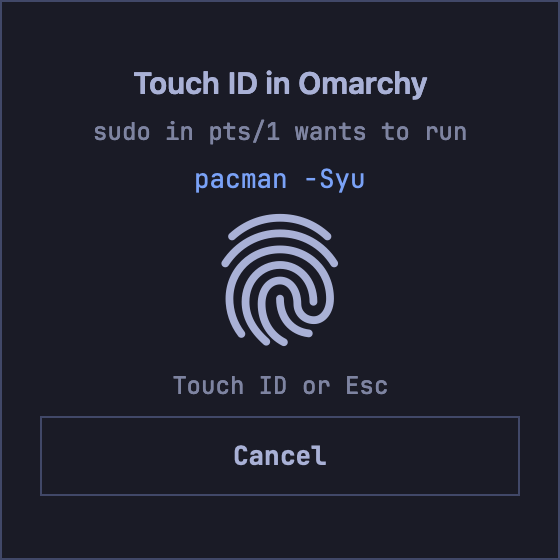

# 0041: Touch ID in the VM: the Mac answers yes or no to the VM's own PAM

Status: accepted (`touch-id`, for 3.0.2). Built for Parallels, UTM,
VMware Fusion and OmacVM.app (its `org.omacvm.auth` port, see Built).

## Context

In Omarchy, sudo, polkit prompts and 1Password's "Unlock using system
authentication" all ask for the Linux password. The Mac next to it has Touch
ID. The wish: touch the Mac's sensor instead of typing.

How the guest side asks today:

- sudo runs PAM service `sudo` (`auth include system-auth` on Arch).
- polkit runs PAM service `polkit-1` in `polkit-agent-helper-1` (a setuid
  helper, or a socket-started root service from polkit 126). Omarchy's
  polkit agent only shows the dialog; the helper does the PAM work. Arch's
  polkit 127 (checked in a VM): the socket-started helper, in a systemd
  sandbox without network (`PrivateNetwork=yes`,
  `RestrictAddressFamilies=AF_UNIX`), and its PAM file only in
  `/usr/lib/pam.d/polkit-1`.
- 1Password for Linux registers `com.1password.1Password.unlock` in
  `/usr/share/polkit-1/actions/com.1password.1Password.policy`
  (`allow_active` = `auth_self`, so polkit never caches the answer). The
  app asks polkit, polkit asks the agent, the helper runs `polkit-1`. So
  anything that answers in `polkit-1` also unlocks 1Password, and the
  1Password CLI and SSH agent prompts that use the same file. 1Password
  still wants its own password on its first unlock after it starts; that is
  1Password's rule, not ours.

How the Bridge knows a VM (ADR 0031): every VM has the shared Bridge token
and checks `/proof` first; requests under `/omacvm/` are also signed with
the VM's own key (HMAC, time, nonce, protocol header, body hash), and the
answer is signed back (`X-OmacVM-Answer`). The Bridge finds the VM from the
peer address in `omacvm vms --json` and the key on the Mac in
`omacvm/vm-keys/`. OmacVM.app's VMs go through the app's relay with the
relay key; the app names the VM. The control centre's key is in the
desktop user's home (`~/.config/omacvm-bridge/vm-key`), readable by every
program of that user.

## Options

PAM side:

1. A C PAM module (`pam_omacvm_touchid.so`). Full control over the
   conversation and timeouts, but a compiled module in every PAM stack,
   built for aarch64 in the VM, and a crash takes sudo with it.
2. `pam_exec.so` and a small client program. Stock PAM, nothing compiled
   into the stack; the client is a separate process, so a hang or crash is
   just "no". `pam_exec` has no timeout of its own and a bare environment,
   so the client sets its own `PATH` and timeouts.
3. `pam_fprintd` with a fake fingerprint reader. Wrong layer, no.

Key:

1. Reuse the control centre's `vm-key`. Any program of the desktop user
   could then sign Touch ID requests and put up Mac dialogs at will.
2. A separate Touch ID key, root only in the VM. Only PAM (root) can ask.

## Decision

pam_exec + client (option 2), a separate root-only key (option 2), one new
signed request on the Bridge, behind a new feature `touch-id`
(experimental at first in 3.0.2, a regular feature since 3.0.5; off by default, `mac,vm`, all routes the Bridge serves:
OmacVM.app, Parallels, UTM, VMware Fusion).

### Guest

- Client `/usr/lib/omacvm/omacvm-touchid` (Python, run with `-I`; runs as
  root; see Built for why not bash + curl + openssl).
- Key `/etc/omacvm/touchid-key` (root, 0600), made by `omacvm apply` when
  the feature goes on; the Mac keeps its copy as
  `omacvm/vm-keys/<vm>.touchid`. Off: both deleted, so a VM that kept its
  PAM lines gets 403 and falls to the password.
- PAM: one line at the top of `auth` in `/etc/pam.d/sudo`, `sudo-i` (where
  it exists) and `polkit-1` only, before `auth include system-auth`. A
  service with only the vendor's file (`/usr/lib/pam.d/polkit-1`) gets a
  copy in `/etc/pam.d` with the line, made again on each apply (so a
  polkit update of the vendor's file is not hidden); off removes the copy,
  so the vendor's file counts again:

  ```
  auth sufficient pam_exec.so quiet seteuid stdout /usr/lib/omacvm/omacvm-touchid
  ```

  `sufficient`: a yes ends auth; any failure is ignored and the password
  prompt follows as before. `seteuid`: without it the client runs with the
  caller's real uid and bash drops root. `stdout`: the client's one line
  shows as a PAM info message (in the terminal for sudo, in the agent's
  dialog for polkit).
  Never in `system-auth`, `login`, `sshd`, `su` or the lock screen
  (`hyprlock`). The lock screen may come later as its own switch.
- polkit's helper sandbox (polkit 127): a drop-in
  (`polkit-agent-helper@.service.d/omacvm-touchid.conf`) allows `AF_INET`
  with `IPAddressDeny=any` and `IPAddressAllow=<the Bridge's address>`, so
  the helper reaches the Mac's Bridge and nothing else. Without it the
  client cannot connect and polkit always asks for the password.
- Only the person at the VM's screen. The client asks only when all hold,
  else it exits 1 at once (logind via `loginctl`):
  - `PAM_USER` is a person (uid 1000 or more, never root) and owns the
    active, local display session on a seat (`show-user -p Display`:
    `Remote=no`, `Active=yes`, a seat, class `user`). So polkit's
    `auth_admin` for a user outside wheel (identity root or another admin)
    and sudo with `rootpw`/`targetpw` never ask.
  - The caller's own login session (the audit session of sudo, or of a
    setuid polkit helper) is not remote and is this user's: on a seat, or
    the user's service manager (class `manager`: Omarchy starts Hyprland
    through uwsm, so every terminal runs under `user@<uid>.service`, audit
    session = the manager's). An SSH login, a cron job (class
    `background`), an audit session logind does not know (cronie sets
    one) or another user's session: no. No audit session at all (polkit
    127's socket-started helper) leaves it to the display session.
  - sudo: `PAM_TTY` is a terminal (`pts/N`, `ttyN`) the user owns. `sudo
    -n` from a program in the background has none and never reaches the
    Mac. The terminal goes into the dialog text.
  - polkit: the polkit rule noted a check for this user less than 5 s ago
    (see below).
  Someone logged in over SSH as another user never puts a dialog on the
  Mac. Logged in over SSH as the same user, `systemd-run --user --pty sudo`
  runs under the user's service manager and can: that is the user's own
  programs (Consequences), not a new boundary.
- What the request says (descriptive only; the guest can lie, and only
  about itself):
  - sudo: `kind: "sudo"`, the command from `/proc/<sudo pid>/cmdline`
    (sudo is setuid, the caller cannot change it after exec) and `tty`.
    Only a command the dialog can show whole and honestly: a `NAME=value`
    word anywhere (sudo allows `sudo LD_PRELOAD=... pacman`; padding in
    front would push it out of sight) or more than 120 characters: no
    Touch ID, the password, and the client says why. Anything but plain
    ASCII is shown as `?`, never dropped.
  - polkit: PAM has no action id. A polkit rule
    (`/etc/polkit-1/rules.d/00-omacvm-touchid.rules`, `00-` so it runs
    before any rule that answers) notes each check of a local, active
    subject with `polkit.spawn` of a small sh writer
    (`omacvm-touchid-note`, about 5 ms) as one line `<time> <action>`
    added to `/run/omacvm-touchid/<user>` (polkitd's folder, 0700), and
    returns `NOT_HANDLED`, so polkit's own decision stays. The client
    reads the last 15 s, leaving out actions whose own file says an active
    user is never asked (`allow_active` `yes` or `no`: the desktop checks
    those all the time). No such note under 5 s old: no Touch ID (the
    password). Exactly one action in the 15 s: `com.1password.*` becomes
    `kind: "1password"`, anything else `kind: "polkit"` with the action
    id. More than one: `kind: "polkit"` without an action ("allow a system
    request"). So a program that runs `pkexec` and then a harmless
    `pkcheck --action-id com.1password.1Password.unlock` gets the generic
    text, never "unlock 1Password". An action made to ask by a local rule
    although its file says `yes` gets no note that counts: the password.
- Transport: Parallels, UTM, Fusion: TCP to the Bridge as today (`/proof`,
  token, then the signed request). OmacVM.app: a new virtio port
  `org.omacvm.auth`, root 0600 by udev rule, so the control centre's port
  (one opener, held up to 60 s by status requests) never blocks a sudo.
  The app relays it like `org.omacvm.control` (see "OmacVM.app's port").
- Timeouts in the client: 1 s to connect, 35 s for the answer, and one
  deadline of 40 s for the whole request (a "Bridge" that drips a byte at a
  time cannot hold sudo or the agent), then exit 1. Ctrl+C in sudo's
  terminal never reaches the client: pam_exec starts it in a session of
  its own, and sudo blocks SIGINT and SIGQUIT while PAM runs. The client
  watches its parent: a stop signal pending at sudo (`/proc/<sudo>/status`)
  cancels the request at once (then sudo's password prompt; a second
  Ctrl+C ends sudo), and the agent's Cancel kills the helper, so the
  client's parent changes and it stops too. Either way the Mac's dialog
  or panel closes.

### OmacVM.app's port

- (3.0.2-3.0.3; from 3.0.4 every VM has the port from its start, whatever
  the setting: see the addendum "On at once".) The port is there only for
  a VM whose features say `touch-id=on` when
  it starts (`MacLinks.touchID`; no features file, or not named: no port).
  Every other VM keeps its device list. A port on `vser0` moves no PCI
  device, and the VM finds it by its name. So turning Touch ID on for an
  app VM takes one restart of the VM: `omacvm apply` says so ("OmacVM.app:
  Touch ID only from the VM's next start"), `omacvm check` on the Mac
  fails its "Mac links" line with "shut it down and start it again" (in
  the VM, from 3.0.4, a hint: "on from the VM's next start"; the control
  centre's row says the same instead of failing), and the client says "Touch ID not available (shut the VM down and
  start it again once)". Off again: the port goes at the next start; until
  then the Bridge has no key for the VM and says `off`.
- The app (`app/app/Sources/OmacVMAuth`, `AuthRelay`) passes each request
  on to the Bridge's relay socket with the Bridge token, the relay key and
  the VM's name (as for the control centre: the guest cannot name another
  VM), plus the guest's own `X-OmacVM-Auth`. The Bridge checks that
  signature with the VM's Touch ID key (`touchIDCaller`, relay path) and
  shows the same system dialog as for the other routes; the app passes the
  signed answer back byte for byte. The app checks no signature and holds
  no Touch ID key. The VM needs no Bridge token for the port (apply keeps
  none there). No 127.0.0.1 fallback as for the control centre: a Bridge
  with Touch ID always has the relay socket; without it the app logs
  "OmacVM Bridge does not answer" and the VM gets the password. Requests
  closer than 0.2 s get status 0; a VM that stops reading its port is
  dropped after 2 s.
- Lines, one JSON object each. VM to app: `{"op":"touchid","id":N,
  "auth":"1 T N SIG","proto":1,"body":"<base64>"}` (N the request's nonce),
  then `{"op":"ping","id":N}` every 0.5 s and `{"op":"cancel","id":N}` on
  the way out. App to VM: `{"ack":true,"id":N}` at once, then
  `{"id":N,"status":S,"answer":"<X-OmacVM-Answer>","body":"<base64>"}`;
  status 0: the Bridge did not answer (the password). The ack matters: a
  virtio port takes the VM's writes even with nobody at the Mac end
  (checked in a VM), so without an ack in 2 s the client says "OmacVM.app
  does not answer" and the password comes. Lines already waiting when the
  app connects are dropped (their clients gave up).
  Lines over 4 KB, bodies over 1 KB, an `auth` whose nonce is not the id:
  dropped.
- QEMU's socket does not tell the app when the VM closes the port, so the
  client pings. No ping for 3 s, a cancel, or a new request (the port has
  one opener at a time, so the old client is gone) drops the Bridge
  connection, and the Bridge closes the dialog (`peerGone`). Answers for an
  earlier client still in the port are skipped by their id.
- polkit's helper (polkit 127, a sandbox with `PrivateDevices=yes` and
  `DevicePolicy=strict`): on app VMs its drop-in binds the port into the
  helper's private `/dev` (`BindPaths=-/dev/virtio-ports/org.omacvm.auth`,
  `DeviceAllow=char-virtio-portsdev rw`) and gives it no network. The
  `-`: a VM without the port yet starts the helper anyway (password).
- A second sudo while one asks: the port is busy (`EBUSY`), "another Touch
  ID prompt is open", the password.
- The guest is untrusted here too: one request to the Bridge at a time per
  VM (a new one waits up to 1 s for the dropped one to end, else the
  password). Only the reading thread closes the port's socket. The HTTP
  lines to the Bridge are one helper (`BridgeHTTP`) for the control centre
  and Touch ID.
- Who asks: from 3.0.2 QEMU's Omarchy panel (the VM window's own process;
  see the addendum), with the Bridge's system dialog as the fallback.

### Request and answer

`POST /omacvm/touchid`, signed as in ADR 0031 but with the Touch ID key
and its own label (`"omacvm-touchid-request 1\n"` ...), so a control
centre signature never counts here and the other way round. Body, strict
JSON, at most 1 KB, unknown keys refused:

```json
{"kind": "sudo" | "polkit" | "1password", "user": "vincent",
 "detail": "pacman -Syu", "tty": "pts/3",
 "action": "org.freedesktop.systemd1.manage-units"}
```

`user` is `[A-Za-z_][A-Za-z0-9_.-]{0,31}` and never `root`; `tty` is
`pts/N` or `ttyN`; `detail` up to 200 bytes, `action` up to 128
(`[A-Za-z0-9._-]`). The Mac turns control, bidi, invisible and unusual
space characters into one plain space (for a client that is not ours) and
cuts `detail` at 120 characters with "… (cut)" (ours never sends longer).

Answer, signed with `X-OmacVM-Answer` (nonce, status, body hash):

```json
{"result": "yes"}
{"result": "no", "reason": "cancelled" | "failed" | "timeout" | "busy"
   | "rate" | "locked" | "not-front" | "no-touch-id" | "lockout" | "off"}
```

The client exits 0 only on a 200 with `result: "yes"`, a valid answer
signature and its own nonce. Everything else, including an unsigned answer
or no answer, is exit 1 (password). The one unsigned answer it reads is a
403 `off` (no key on the Mac, so it cannot sign), and only to say "Touch ID
off".

### Mac (Bridge, `touchid.swift`)

- Only VMs this Mac's OmacVM set up: the VM found as for `/omacvm/`
  (address or app relay) must have a Touch ID key on the Mac and the
  feature on. Unknown VM, no key, bad signature: 403, no dialog.
- Fast no, before any dialog: feature off (`off`), Mac screen locked or
  display asleep (`locked`), the VM's app (OmacVM.app, Parallels, UTM,
  Fusion) not the frontmost app (`not-front`), `canEvaluatePolicy` false:
  no sensor, no finger enrolled, lid closed without a Touch ID keyboard
  (`no-touch-id`), too many failed tries (`lockout`).
- The dialog: a fresh `LAContext` per request, never reused or kept
  (`touchIDAuthenticationAllowableReuseDuration` 0), invalidated at the
  end. Policy `.deviceOwnerAuthenticationWithBiometrics` with no fallback
  button (`localizedFallbackTitle = ""`). The Mac password as fallback
  only when the person turns on `touch_id_password_fallback` in the
  Bridge's `config.json` (then `.deviceOwnerAuthentication`).
- One dialog at a time on the Mac (`busy` for the next one). Per VM: one
  request every 2 s, 10 a minute; after 3 misses in a row (`cancelled`,
  `failed` or `timeout`) a pause of `rate`: 60 s, then 5 min, then 30 min,
  until a yes. So a VM that keeps dialogs up for nobody stops after three.
  The VM's client asks once more 2.2 s after a `rate` (3.0.4): `sudo -v`
  and then `pkexec` or 1Password at once both get Touch ID, and the Mac's
  spacing stays; a second `rate` (a real pause) means the password.
  A dialog not answered in 30 s is invalidated (`timeout`); a client that
  disconnects invalidates it too.
- The Mac's state (screen locked, app in front) is read on the main thread.
- Nothing about the finger leaves the Mac: macOS gives the Bridge only
  success or an error code, and the VM only gets yes or no.
- Log: one line per request (VM, kind, result, never `detail`); refusals
  and the fast `rate`/`busy` noes at most once a minute per kind.

### Texts

macOS shows: "OmacVM Bridge is trying to <reason>. Touch ID to allow this."
So the reason starts with a verb:

| kind | reason |
|---|---|
| `1password` | `unlock 1Password in Omarchy` |
| `sudo` | `run sudo in Omarchy (pts/3): <command>` |
| `polkit` with action | `allow "<action id>" in Omarchy` |
| `polkit` without | `allow a system request in Omarchy` |

With several VMs set up, " (<VM name>)" follows "Omarchy" (for sudo:
"Omarchy (<VM name>, pts/3)").
In the VM, the client's one line (PAM info):

- asking: `Touch ID on your Mac, or wait for the password prompt`
- fast no: `Touch ID not available (<why>), use your password`, why from
  the reason: `Mac locked`, `VM not in front`, `no Touch ID`, `too many
  tries`, `Touch ID off`, `VM clock off`. Silent for
  `cancelled`/`failed`/`timeout`; the password prompt is the message.
- a sudo command it does not send: `Touch ID not used for this command
  (too long or sets variables), use your password`

Control centre and CLI: the row "Touch ID" with "Unlock 1Password, sudo
and system prompts with the Mac's Touch ID. Your password keeps working."
`omacvm enable touch-id`, `omacvm disable touch-id`. `omacvm check`
reports: the keys in the VM, the PAM lines, the polkit rule and its note
writer. Not yet: a row in `omacvm check --mac-only` (key on the Mac,
sensor) and the last result.

## Consequences

- A yes protects only the VM's own boundary, the same as the VM password:
  it never unlocks anything on the Mac, and macOS asks again every time.
  Anyone who has root in the VM has the key and can ask for dialogs; a
  yes then gives them nothing they did not have.
- The desktop user's programs cannot ask directly (no key), but they can
  run `sudo` or `pkexec` and so put up a dialog. Without a terminal they
  could not pass sudo before, and with Touch ID they still cannot reach
  the Mac (no `PAM_TTY` of the user's: password). A program can open a
  terminal of its own (a new pty is the user's) and run sudo in it; the
  dialog then names that terminal ("pts/7") and the command. What the text
  can prove: the command sudo was started with, whole, and the terminal
  number. What it cannot: that the person typed it. The "VM in front" rule
  keeps dialogs from appearing while the person does something else on the
  Mac, and a dialog the person did not expect is a reason to cancel.
- The sudo command goes to whoever passes `/proof`: any VM with the Bridge
  token that takes the Mac's address can read it (it gets no yes). Do not
  put secrets on sudo's command line (that holds without Touch ID too).
- `touch_id_password_fallback` (`.deviceOwnerAuthentication`) also
  accepts an Apple Watch's approval and the Mac's password, as macOS does.
- polkit's helper may use the network to the Bridge's address (the
  drop-in above); polkit's other sandboxing stays.
- Another VM on the same network can answer in the Mac's place (ADR
  0031's impostor case), but cannot sign: the answer is a no.
- The password always works. Mac asleep: the VM is paused anyway; Mac
  locked, no sensor, Bridge not running, network down: the client says
  no within about a second and the password prompt comes.
- pam_faillock stays in `system-auth`, after our line: a Touch ID yes
  passes even while faillock locks the password. Accepted: faillock stops
  password guessing, and a Touch ID yes is not a guess.
- Tests: the Bridge's Touch ID decisions behind a protocol with a mocked
  `LAContext` (yes, no, error codes, timeout, disconnect, rate, busy); the
  client and PAM stack in a test VM against a mock Bridge (sudo,
  `pkexec true`, a polkit action standing in for 1Password; remote session
  refused; Bridge down falls to the password in under 2 s). One manual
  check with a real finger, by the person, on a Mac with Touch ID.
- OmacVM.app: turning Touch ID on or off took one restart of the VM (its
  port was added or removed at the start). From 3.0.4 it takes none: every
  start has the port (addendum "On at once").

## Built

- Mac: `src/bridge/mac/touchid_policy.swift` (request, texts, limits, the
  order of the checks) and `touchid.swift` (LocalAuthentication, the Mac's
  state, the request). `control.swift` finds the VM and checks the
  signature (`touchIDCaller`); `requestMAC`, `answerMAC` and
  `verifyControlAuth` take the label.
- VM: `src/bridge/guest/omacvm-touchid` (the PAM client; Python, run with
  `-I`, not bash + curl + openssl: no key or token in any process's
  arguments, and the timeouts in one place), `touchid.sh on|off` (the PAM
  lines, the polkit rule `49-omacvm-touchid.rules`, `/run/omacvm-touchid`
  through tmpfiles, owned by `polkitd`), `guest/install.sh` and
  `omacvm check`. The polkit rule notes the action by user name (polkit
  gives rules no uid).
- Keys: `omacvm apply` makes `vm-keys/<vm>.touchid` (`touchid_key_ensure`)
  and puts it and the Bridge token in `/etc/omacvm` (root, 0600); off: the
  Mac's copy goes in apply, the VM's in `touchid.sh off`.
- The feature is on for a VM exactly when its Touch ID key is on the Mac:
  no key, 403 `off`, no dialog.
- Tests: `src/bridge/mac/tests/run.sh` (LAContext and the Mac's state
  mocked: request shapes, texts, every fast no, rate, pause after misses,
  busy, timeout, client gone, labels kept apart) and
  `src/tests/touchid-client.sh` (the client against a fake Bridge: yes, each
  no, unsigned, other key, other nonce, Bridge without the token, another
  PAM service, SSH, no key, polkit notes, Bridge down under 2 s; PAM lines
  in and out byte for byte). Both in CI.

- Review fixes (Fable 5.1, 2026-10-06): label only for a single noted
  action (H1); the display session and the caller's session from logind,
  uwsm terminals included (H2, M1, M5); sudo only from a terminal of the
  user's, named in the dialog (H3); no cut or `NAME=value` commands, `?`
  for non-ASCII, more characters cleaned on the Mac (M3); one 40 s
  deadline (M2); timeouts count as misses, growing pauses (M4); the
  smaller ones (main thread, fast noes in the log, unsigned `off`, `VM
  clock off`, `sudo-i`, user names with dots, the client stops with its
  caller, a sh note writer).
- App port VM pass (2026-10-06, MacBook Pro, QEMU-direct test VM with the
  port as `Runner.swift` adds it, `AuthRelay` in a harness as
  `Runner.startAuth` runs it, a stand-in Bridge on a Unix socket; no Touch
  ID dialog): sudo in a uwsm foot terminal asked through the port and was
  let in (224-250 ms), `pkexec true` too (506-526 ms; needs the device
  drop-in above), a no gave the password prompt, Ctrl+C dropped the
  Bridge connection at once, `kill -9` of the client after 2.9 s (pings
  stopped), the port held by another opener: "another Touch ID prompt is
  open", the app not relaying: "OmacVM.app does not answer", SSH never
  asked, no Bridge token in the VM. A helper without the port still asks
  for the password.
- The same pass through the real app (2026-10-06, MacBook Pro, OmacVM
  Test.app built from this branch, hidden, its relay pointed at the
  stand-in Bridge): the app gave the VM the port (`Mac links: ... Touch ID
  on`), sudo let in in 46-76 ms, `pkexec true` in 100-106 ms; no, Ctrl+C,
  `kill -9` (dropped after 3.0 s), port busy, SSH as above.
- Real dialog through the app's path (2026-10-06, MacBook Air M2, macOS
  26.6.2): the Bridge built from this branch (test identity), `AuthRelay`
  as the app runs it, the VM's request signed with a Touch ID key the Mac
  knows, a diskless QEMU window in front. The macOS Touch ID dialog
  (`coreautha`) came up 1.4 s after the request, without a click;
  Escape closed it, and the VM got the signed answer `no`, `cancelled`.
  Bridge log: `touchid: from relay (OmacVM A-tidapp): 200 sudo no
  cancelled`. The first request right after the Bridge started got 409
  `unknown-vm` (its VM list was still being read): the password that
  time.
- Test VM pass (2026-10-06, OmacVM.app test VM on the MacBook Pro, Arch
  ARM: sudo 1.9.17p2, polkit 127, systemd 262, Hyprland 0.56 through uwsm;
  the real PAM stacks and polkit, a stand-in Bridge on 127.0.0.1 in the
  VM, no Touch ID dialog anywhere): sudo in a foot terminal started as
  Omarchy starts it (uwsm app): Touch ID asked, `{"kind":"sudo",
  "detail":"true","tty":"pts/0"}`, let in, 47 ms; `pkexec true`: asked
  (`org.freedesktop.policykit.exec`), let in, 98 ms; a stand-in
  `com.1password.1Password.unlock` (`allow_active` `auth_self`) through
  `pkcheck --allow-user-interaction`: `kind "1password"`, let in; right
  after a pkexec, the generic text. Over SSH: sudo and pkexec never ask
  (password prompt at 55 ms and 105 ms). `systemd-run --user sudo -n`:
  never asks. Bridge down: sudo's password prompt at 66 ms, polkit's
  client done 82 ms after pkexec started; a Bridge address that does not
  answer: 1.08 s. Without the helper drop-in, pkexec never reached the
  stand-in (the sandbox). The polkit rule costs about 5 ms per check of a
  local subject (11 ms against 6 ms).

- OmacVM.app (2026-10-06): the `org.omacvm.auth` port (`Runner.swift`,
  only with `touch-id=on`, `MacLinks.touchID`), `AuthRelay`
  (`app/app/Sources/OmacVMAuth`), the client over the port
  (`over_port`), the udev rule `70-omacvm-auth.rules` (in `touchid.sh`),
  the restart notices (`app_links_stale`, `omacvm check`). Tests:
  `swift run auth-tests` (the relay with the port and the Bridge as socket
  pairs: answer byte for byte, pings, cancel, a new request, no Bridge,
  junk), `src/tests/touchid-client.sh` (the client against a stand-in port
  that relays to the fake Bridge: yes, each no, stale answers, the app
  gone, no port, the pings, Ctrl+C and the deadline closing the dialog),
  `src/tests/features-off.sh` (the port only with `touch-id=on`, the
  restart notices).

Still to do:

- The manual check with a real finger (the person, on a Mac with Touch ID,
  a Parallels, UTM or Fusion VM): `omacvm enable touch-id`, then in an
  Omarchy terminal `sudo -k; sudo true` (Touch ID dialog "run sudo in
  Omarchy (pts/N): true", touch: no password); again and Cancel on the Mac
  (the password prompt); `pkexec true` (dialog "allow
  "org.freedesktop.policykit.exec" in Omarchy", touch); the Mac locked or
  another app in front (password at once); 1Password's "Unlock using
  system authentication" after its first unlock ("unlock 1Password in
  Omarchy").

## Addendum (3.0.2): the Touch ID panel in the Omarchy theme

Status: built (`touch-id-302`, 2026-10-06). Touch ID stays opt-in and off
by default; this only changes what the Mac shows once it is on.




### What

For OmacVM.app's VMs the Mac asks in its own panel instead of macOS's
dialog: a 280 pt square centred on the VM's window (3.2.11: the one on the
display under the Mac's pointer, see the addendum at the end), framed and coloured as
Omarchy frames its own password prompt for the VM's theme (3.0.4: its
background, text and accent, a 2 pt border in Hyprland's active border
colours, a gradient too, and Hyprland's rounding): "Touch ID in Omarchy",
one plain line saying what asks, the verified command, the fingerprint
glyph (five strokes, round caps), a state line ("Touch ID or Esc"), Cancel
(an Omarchy control). All text is JetBrains Mono. The glyph follows the
chosen "Ridge" design: while it waits it breathes; a finger it does not
know or a lockout turns it red, it jolts, the panel shakes and its border
turns the error colour (0.6 s); a yes shows the green check in its place.

Nothing waits for the panel (3.0.4): the yes goes to the VM the moment
macOS says the finger matched, the keyboard and pointer go back to the VM
in the same moment, and the check stays only 90 ms (none with "Reduce
motion"), with no fade. 3.0.2 and 3.0.3 played a trace and a drawn check
for 1.6 s, and QEMU kept the guest's input until the panel closed, so
typing right after the yes went nowhere.

Parallels, UTM and VMware Fusion keep macOS's own dialog.

### Where it lives: the VM window's own process

macOS reads a finger for an embedded Touch ID view (`LAAuthenticationView`)
only in the app in front. A panel from OmacVM Bridge (an agent in the
background, the first build of this addendum) showed and took Esc and
clicks, but the finger counted only after a click on the panel made the
Bridge the active app (prototype on the MacBook Air, 2026-10-06 19:38). So
the panel is shown by the process that owns the VM's window, which is in
front whenever the VM asks (the Bridge checks that first, `not-front`):

- OmacVM.app: QEMU. `OmacVMTouchIDPanel.dylib` (in the app,
  `Contents/Resources/runtime/lib`, signed like QEMU, so library validation
  lets it in) holds the panel. QEMU loads it at launch when the VM starts
  with `touch-id=on` (`OMACVM_TOUCHID_PANEL`, `OMACVM_TOUCHID_PANEL_SOCKET`
  in the app's private run folder; `omacvm-cocoa-touchid-panel.patch`).
  While the panel is up QEMU lets go of the pointer and the guest's held
  keys, its full-grab tap lets keys through to the panel (the key window),
  and clicks, moves and scrolls on the VM's windows wait.
- Parallels, UTM, Fusion: their window's process is not ours, so macOS's
  dialog (it needs no click: coreauthd shows it).

### The path of a request (OmacVM.app)

1. The VM's PAM client asks on `org.omacvm.auth`; `AuthRelay` sends it to
   the Bridge's relay socket with `X-OmacVM-Panel: 1` (it can show the
   panel).
2. The Bridge checks everything as before (signature, VM, limits, the Mac
   locked, the VM's app in front, Touch ID available). When it would show
   its dialog, it sends an interim answer on the same connection instead:
   `HTTP/1.1 103 Touch ID Panel` with `X-OmacVM-Panel: <base64 JSON>` (the
   words from the verified request, `touchIDPanelText`, the timeout, and
   the VM's theme colours).
3. The app has QEMU's panel show it (JSON lines on the panel's socket) and
   writes the panel's end back to the Bridge as one line: `yes`,
   `no <reason>` (cancelled, timeout, failed, lockout, no-touch-id,
   not-front, locked) or `error` (the panel could not show).
4. The Bridge counts the end as for its own dialog (misses, pauses) and
   signs the final answer with the VM's Touch ID key; the app passes it to
   the VM byte for byte. `error`: the Bridge shows macOS's dialog in the
   same request (nothing was on screen yet).

Trust: the panel's end comes from OmacVM.app, this Mac user's own program
behind the relay key. That is no weaker than before: a program of this user
can read the VM's Touch ID key on this Mac anyway. The guest still gets only
a signed yes or no, and never reaches the panel's socket or the relay.

### Fallback to macOS's dialog

- `touch_id_password_fallback` on (the Mac password needs the dialog).
- `"touch_id_panel": false` in the Bridge's `config.json` (default on).
- An app or runtime without the panel (no dylib, older QEMU): the app sends
  no `X-OmacVM-Panel`.
- The panel cannot show: no socket, no VM window, QEMU not in front, or the
  embedded view ended within 0.5 s with an error that says nothing about a
  finger. Then `error`, and the dialog. A request is never asked twice after
  the person could have seen a prompt (a later error is a `failed`).
- The command (or polkit action) does not fit the panel's box whole (two
  lines, about 60 characters): the dialog shows all of it (at most 120).

### The theme

The VM sends its colours with `POST /omacvm/theme` (signed with its control
key; only with Touch ID on; at most 512 bytes, one a second): `background`,
`foreground`, `accent`, `error` (shell.toml `[polkit]`: background, text,
accent, text-error; else colors.toml), `success` (colors.toml `green`),
`muted` (colors.toml `muted`, for the 3.0.2/3.0.3 panels), and the border
(the prompt's own when the theme gives one, else Hyprland's
`general:col.active_border`, one colour or a gradient with its angle,
Hyprland's angle with y down; a longer gradient gives its first and last
colour; a `$variable` falls back to Hyprland's own border) and
`decoration:rounding`. The Bridge passes all of it to the panel in the 103
(3.0.4; before, only the colours). Guest: `omacvm-touchid-theme` from a
user path unit on `~/.local/state/omarchy/current`, once its files have
been quiet for 0.8 s (at most 3 s), and again 1.5 s later if Hyprland's
border or rounding changed meanwhile (a switch reloads Hyprland last); at
each login; and at once when Touch ID is turned on (touchid.sh clears its record of the last send, which
also holds the boot). The Mac keeps the last good theme per VM, also while
Touch ID is off, so the panel follows the VM's last known theme until a
new one comes (a VM rebuilt under the same name, `--reset-host-key`,
starts without it) (3.0.2 and 3.0.3 deleted it on off and did not send it again
on on: the user's light VM got a dark panel). Mac rules:
`#rrggbb` only; text under 4.5:1 on its background refuses the whole theme
(all 22 stock themes pass, lowest rose-pine 6.7:1); accent, error and
success under 3:1 become the text colour (success: catppuccin-latte),
muted under 1.3:1 a mix of background and text; kept per VM in
`touchid-theme/` (0600). Tokyo Night until a theme arrives. The font is
always the bundled JetBrains Mono (OFL 1.1), never one the VM names.

### Security

- Nothing in the panel says yes: only a finger in Apple's view. Cancel, Esc
  and Cmd-. cancel; Return does nothing; keys with OmacVM's marker (posted
  by its helpers, which a VM can cause) are ignored.
- It closes when the VM's client goes away (the app tells the panel), on
  the timeout, when the Mac locks, and when another app comes to the front
  (`not-front`, not a miss). One panel at a time.
- The words come only from the request the Bridge verified; the guest sends
  colours, nothing that is shown as text.
- The command is shown whole or not in the panel at all: a command cut in
  the middle could hide what runs (`pacman -Syu …noconfirm` with a
  `--hookdir` in the gap). A longer one goes to macOS's dialog (security
  review, 2026-10-07).

### Tests

- `swift run touchid-panel-tests` (app/app): theme and frame (the 103's
  border and rounding through the app to the panel), glyph paths, words that
  fit (shown whole, else macOS's dialog), keys, how an evaluation ends and
  how long each end stays, placement, the view drawn off screen (never on
  screen, no `LAContext`). `--live OUT.json` (a test Mac's screen, never
  CI): the real controller and window with a stand-in that ends on cue,
  timing the answer, the input going back and the panel leaving the screen.
- `swift run auth-tests`: the prompt and answer lines, the interim 103, the
  relay with a Bridge that asks for the panel, the client going away during
  the panel, the panel's socket (show, close, no panel).
- `src/bridge/mac/tests/run.sh`: the theme's rules with the 22 stock themes
  (with green and muted), the app panel's answer lines (never a yes from
  junk), the decider passing the app's panel on.
- 3.0.4, MacBook Air (macOS 26.6.2) screen, `--live` (5 runs each, ms
  after the finger's end; 3.0.3's panel -> this one): a yes went out to
  the app 0.2 -> 0.2, the input went back to the VM 1670 -> 0.4, the panel
  left the screen 1836 -> 109 (Reduce Motion 1836 -> 13); not recognised
  1052 -> 0.4 input, 1218 -> 636 screen; a cancel 176 -> 17 screen. The
  real window in Tokyo Night, Flexoki Light and a rounded gradient theme
  (`--show`). MacBook Pro, hidden test VM (2026-10-07; no Touch ID dialog
  there): the theme reached the Bridge 1.2 s into `omarchy-theme-set`
  (which takes 3.4 s; final colours each time, kanagawa with Hyprland's
  border), at login, and again during `enable touch-id` after a
  `disable` (the Mac's copy stayed); with a stand-in that says yes at
  once, sudo ended 18-24 ms after the yes (55-63 ms in all), the same
  with 3.0.3's app: that path never waited.
- pytest: the guest sender with `success` and `muted`, Omarchy's prompt
  colours (`[polkit]` accent, the prompt's own gradient border, Hyprland's
  token), a light theme without shell.toml (Flexoki Light), sending once
  per change and boot and again after on/off, the wait for a switch to
  settle.
- MacBook Air (macOS 26.6.2, Touch ID, 2026-10-06 23:04-23:20; the test
  app's QEMU and dylib, its test Bridge, the relay as Runner runs it, a
  guest stand-in; no finger at night). The panel came from QEMU (its pid,
  level 28, 280x280, centred) 3-4 s after the request, windowed and in full
  screen with QEMU's full grab, dark and light (catppuccin-latte from the
  Bridge's copy). macOS armed the sensor for it with no click: coreauthd
  "will start matching user 501" for QEMU's context with the embedded UI,
  biometrickitd `match:withOptions`. Escape (also under the full grab), a
  Cancel click, the 30 s timeout, the caller going away and Finder to the
  front each gave the signed no (`cancelled`, `timeout`, `not-front`) and
  closed the panel. Without the panel (no dylib loaded) the app said
  `error` and the Bridge showed macOS's dialog in the same request. The
  first request after a Bridge start still gets `unknown-vm` once (the
  Bridge's VM list is cold): the password that time.
- MacBook Pro VM pass (2026-10-06 23:26-23:40; headless clone of a 3.0.0
  VM, only the `org.omacvm.auth` port; the relay as Runner runs it with a
  stand-in Bridge and a stand-in panel, no dialog or window on that Mac):
  real PAM, polkit 127 and the port. sudo and pkexec yes with and without
  the panel path (64-129 ms; the Bridge's 103 and the app's `yes` line),
  the panel's `no cancelled` gives sudo's password prompt, a SIGINT to sudo
  alone with the panel up (`timeout -s INT`, not a real Ctrl+C: see the
  3.0.2 Air re-check below) closed the panel, SSH never
  asks, `touchid.sh off` takes it all out. A pkexec within 2 s of a sudo
  gets the password: the Bridge's own 2 s rule (and the relay's 0.2 s).
- MacBook Air re-check of the 3.0.2 candidate (5c7fc40b, 2026-10-07 03:01-03:40;
  the test app, a fresh VM from the 3.0.0 image, `omacvm enable touch-id`,
  full screen, Omanotch on). Two bugs, both fixed in #204: (1) the Bridge
  answered `not-front` to every request: since DockIdentity (3.0.1)
  LaunchServices names `Contents/MacOS/OmacVM` for QEMU, and `frontType`
  read that before the kernel's path. (2) A real Ctrl+C (typed in the VM's
  terminal) left the panel up for its 30 s: the client runs in its own
  session and the SIGINT waits at sudo; the client now watches for it and
  the panel closed 0.5 s after the Ctrl+C. With both fixes: the panel from
  QEMU with no click and the sensor armed; Escape, a Cancel click, the
  timeout, Finder to the front each a signed no and the password; the
  panel follows an Omarchy theme switch (catppuccin-latte reached the
  Bridge 3 s after `omarchy-theme-set`); after three misses the fast
  `rate` no; `"touch_id_panel": false` shows macOS's dialog, no click,
  Escape works; the Bridge stopped: the password after about 110 ms.

## Addendum (3.0.4): apps with their own switch, and "from the next start"

Status: built (`touchid-hint`, 2026-10-07). Touch ID stays opt-in and off
by default.

### Apps that ask polkit only when told to

Touch ID answers sudo and polkit. An app that unlocks through polkit asks
it only with its own switch on, and until then keeps asking for its own
password: Touch ID looks broken for it. Checked (2026-10-07):

- 1Password (the main case in Omarchy; omarchy-mac installs the aarch64
  tarball: `/opt/1Password`, `/usr/share/applications/1password.desktop`,
  `/usr/share/polkit-1/actions/com.1password.1Password.policy`). Settings
  › Security › "Unlock using system authentication", off by default
  (support.1password.com/system-authentication-linux). In
  `~/.config/1Password/settings/settings.json` it is
  `"security.authenticatedUnlock.enabled": true`; the file holds only the
  settings changed from their defaults. Since 8.10.38 1Password signs
  sensitive settings (`authTags`, one per key) and resets an unsigned one
  at its next start (support.1password.com/settings-security, kb/202408c).
  So OmacVM never writes the setting (1Password would undo it and it is
  1Password's security choice), and a `true` without its tag counts as off.
  The key and the tags were checked in real settings files of 1Password
  for Linux 8.x (public dotfiles), not in a signed-in 1Password here (no
  account in a test VM).
- Bitwarden (desktop, Linux arm64 tar.gz and snap): Settings › Security ›
  "Unlock with system authentication" (bitwarden.com/help/biometrics).
  Listed only, not read: its settings file was not checked.
- KeePassXC: quick unlock through polkit
  (`org.keepassxc.KeePassXC.unlockDatabase`) only from 2.8.0 (beta1,
  2026-09-23; 2.7.x has none on Linux), Settings › Security › "Enable
  database quick unlock", on by default. Listed only.

What the person sees, Touch ID on and 1Password installed:

- While its switch is off, one desktop notice: "1Password: turn on
  Settings › Security › Unlock using system authentication to use Touch
  ID." `omacvm-touchid-apps --notify` (the desktop user) sends it from
  `omacvm-touchid-apps.service`, which runs when Touch ID is turned on, at
  login (`graphical-session.target`) and when 1Password's polkit action
  appears (`omacvm-touchid-apps.path`). Once per app: a mark in
  `~/.local/state/omacvm/touchid-hint-<app>`, cleared when Touch ID is
  turned on again (`touchid.sh on` from off). Never while the switch is on.
  No notification daemon yet: no mark, the next trigger tries again.
- A line in `omacvm check` and the control centre's Touch ID details
  (guest `check.sh`, as the desktop user): a hint (skip, needs a person)
  with the same words while off, "1Password: uses Touch ID" (ok) once on.
  Never a failure: Touch ID itself works.
- The details list the three apps and their switches.

### From the VM's next start

On OmacVM.app the port comes at the VM's start, and a reboot inside the VM
keeps the same QEMU (`-action reboot=reset`). Touch ID turned on while the
VM runs was a red x ("failing") in the control centre. Now the guest check
is a hint ("on from the VM's next start: shut it down, then start it
again"), and the control centre gives the row its own state, "from the
next start" (the refresh glyph, blue), when Touch ID is on in an app VM
that has no `/dev/virtio-ports/org.omacvm.auth` (`local.next_start`). A
real failure (no key, no PAM line) still wins. OmacVM.app's own window is
hidden while the VM runs (the Dock icon brings QEMU's window to the front),
so it has nothing to show; when the VM is stopped the next start has the
port anyway.

### Tests

- pytest `test_touchid_apps.py`: no 1Password, 1Password found by any of
  its three files, never set, signed on, unsigned on (off), a file from
  before signatures, unreadable file, `XDG_CONFIG_HOME`, one notice and no
  second, none while on, no daemon then a retry; the control centre's
  status order with "next start", the port test, the details text, and
  the row plus details in Textual's headless driver.
- `src/tests/touchid-client.sh`: `touchid.sh` installs the script and its
  two user units and takes them out again.

## Addendum (3.0.4): on at once

Status: built (`touchid-onboarding`, 2026-10-07). Touch ID stays opt-in and
off by default; this is about the moment a person turns it on.

### What went wrong (3.0.3, the user's MacBook Pro, 2026-10-07 06:02-06:55)

1. OmacVM.app added `org.omacvm.auth` only at a start with `touch-id=on`.
   Turned on while the VM ran, Touch ID waited for a shut down and start;
   the control centre showed a red x meanwhile, and the person turned it
   off again.
2. `omacvm enable touch-id` restarted OmacVM Bridge (06:41:47, 06:43:11,
   06:51:39). `src/mac/install.sh` keys each helper's stamp on a sum of its
   files listed with `sort -z`, in the caller's locale: the control
   centre's jobs run with `LANG=en_US.UTF-8` (`ControlRun`), a terminal
   often without. Two orders, two sums: each switch between the two built
   and restarted Bridge, Gestures and Omanotch.
3. The first request after that restart got `409 unknown-vm` (the Bridge's
   VM list was still empty). The log said `from relay (-)`: that was only
   the log line using the found VM's name; the app had sent it. The 409 is
   unsigned (no VM, no key), so the client fell to the password without a
   word, and 1Password asked for its password.

### Decision

- Every start of an OmacVM.app VM has the port, its relay (`AuthRelay`) and
  the panel (`OMACVM_TOUCHID_PANEL`), whatever the setting. qemu.log's Mac
  links line says `Touch ID port on`; `app_touchid_port` reads it (and
  3.0.2/3.0.3's `Touch ID on`). The one restart this needs is the 3.0.4
  update's own.
- Off stays off: no PAM line and no client in the VM, so nothing opens the
  port; the udev rule keeps it root's alone also while off (`touchid.sh
  off` writes it on app VMs; without it the kernel's default is 0600 root
  too). The app reads the VM's features per request (`AuthRelay`'s
  `enabled`): off, it answers `403 off` itself, as the Bridge would
  (unsigned: neither has a key then), and nothing reaches the Bridge. On,
  it relays at once, no restart. Behind it the Bridge still has no key
  for a VM with Touch ID off and answers `off` (no dialog, no panel: the
  panel shows only a prompt the Bridge sends after it verified the request
  with the VM's key). A process with root in the VM can send requests
  while off and gets `off`; the relay's 0.2 s limit holds. The panel's socket is in the app's private run folder
  (0600), as before.
- The Bridge takes an OmacVM.app VM's Touch ID request by the name the app
  sends when this Mac has that VM's Touch ID key (`touchIDRelayVM`), without
  waiting for `omacvm vms`. The name comes from the app over the relay
  socket with the relay key (the guest cannot name a VM); the request came
  through that VM's port in the running app, so the VM runs; the key file
  says OmacVM set it up and the feature is on. Nothing a program of this
  Mac user could not do before: it can read the VM's key and the relay key.
  Parallels, UTM and Fusion still need the list for the address: a request
  from an address it does not have waits up to 10 s for a fresh one (the
  control centre's requests 4 s; the client allows 35 s).
- The helper stamps are summed in the C locale: the same sources are up to
  date whoever runs `omacvm`, and a feature switch never restarts the Bridge.
- The client never falls to the password silently where the person expected
  Touch ID. One line says why ("Touch ID not available (the Mac is still
  starting: try again in a moment), use your password"; the Bridge down;
  OmacVM.app does not answer; no key or token in the VM; an answer that
  does not check out). The Bridge's refusals it cannot sign (`off`,
  `unknown-vm`, `vm-key`) are read unsigned only for that line; any other
  unsigned answer is "did not check out", never its own reason. Silent as
  before: the person's own answer on the Mac (cancelled, no match, timeout)
  and the cases that never ask (SSH, a job without a terminal, another
  session), so a job's output stays clean. Every outcome goes to the journal
  (`journalctl -t omacvm-touchid`), never the command.
- Turning it on ends with what to do next: `omacvm enable touch-id` (and so
  the control centre's job) says "Touch ID is ready: try sudo -v in an
  Omarchy terminal" once the VM has its key and PAM line, or "on - restart
  the VM once to finish" for a VM an older OmacVM.app started; then each app
  that needs its own switch (`omacvm-touchid-apps`, the 3.0.4 addendum
  above). The control centre's banner says the same from the VM's side.
- `omacvm check`: "Touch ID (Mac)" says what the Mac lacks (the VM's key,
  OmacVM Bridge, its socket for OmacVM.app, a fingerprint: `bioutil -c`),
  the next start for an older app's VM (for the person, not a failure), and
  the last request the Bridge logged for the VM; in the VM, "Touch ID last
  request" from the client's journal line. Touch ID left the Mac links row,
  which the control centre shows under Omanotch.

Not done: a "Restart VM" button in OmacVM.app's window for a VM without the
port. Such a VM was started by OmacVM.app 3.0.3 or older, so that older app
runs it and no 3.0.4 code is there to show a button; the update to 3.0.4
restarts it. The control centre (touchid-hint) and `omacvm check` say "from
the VM's next start".

### Routes

| Route | Turning Touch ID on while the VM runs |
|---|---|
| OmacVM.app | the port is there from the start: the key on the Mac, the PAM lines in the VM, and the next sudo asks |
| Parallels, UTM, Fusion | as before over the network: the key and the token in the VM, the polkit helper's drop-in (`daemon-reload`), the next sudo asks; the Bridge no longer restarts, and an address it has not listed yet waits for the list instead of `409` |

### Tests

- `swift run auth-tests`: Touch ID off in the VM's features: the app answers
  `403 off`, the Bridge is never asked; turned on while the relay runs: the
  next request is relayed.
- `src/tests/mac-install.sh`: the stamp and `helpers_src_sum` are the same
  with `LANG=en_US.UTF-8` and without (both differed before).
- `src/bridge/mac/tests/run.sh` (touchid): `touchIDRelayVM` with an empty
  list, the list's entry, a stale list, a Parallels VM of the same name, no
  key, no name; `touchIDListWait` between the control centre's wait and the
  client's 35 s.
- `src/tests/features-off.sh`: the record (`Touch ID off, Touch ID port on`
  for every VM), `app_touchid_port` for 3.0.4, 3.0.3 with and without
  touch-id at the start, an app from before, no log; Touch ID out of the
  Mac links row.
- `src/tests/touchid-client.sh`: every fallback's line and journal line
  (`unknown-vm` over TCP and the port, `vm-key`, unsigned other codes, the
  Bridge down, no proof, no key, no token, status 0, the app hanging up),
  silence and a journal line for SSH and no terminal; `touchid.sh off`
  keeps the port rule on app VMs.
- `src/tests/touchid-ready.sh`: apply's last word (ready, restart once for
  3.0.3's VMs, not running, 1Password's switch, not set up, nothing when it
  was on before), check's "Touch ID (Mac)" for each missing piece and the
  last request, the VM's "Touch ID last request".
- pytest `test_touchid_ready.py`: the control centre's banner after "Touch ID
  on" (ready with 1Password's switch; restart once without the port; ready
  with it) in Textual's headless driver.

## Addendum (3.2.11): the panel on the display you work on

Status: built (`touchid-external-screen`, 2026-10-28). Only
`OmacVMTouchIDPanel.dylib` changes.

### What went wrong (3.2.9, the user's MacBook Pro M4 Max with an LG UltraFine 5K, 2026-10-28)

The VM in full screen with "Use external displays" (both defaults), the person
at the LG: 1Password's unlock showed the panel on the built-in screen. The
Bridge's log said the app's panel showed and the finger counted, so only the
place was wrong.

The panel centred itself on QEMU's key window. With "Use external displays"
QEMU's main window (Virtual-1) stays on the display the VM started on, and
QEMU hands the keyboard back to it at every click in another display's window
(`omacvm-cocoa-head-key-same-space.patch`): the key window is always the main
window, on the built-in here. A VM in a window (one window) was right on any
display. Reproduced on the Mac mini with two virtual displays of our own, the
3.2.9 test QEMU and its panel (results in the lane's notes, rows `heads1`):
main window on A, pointer on B: the panel on A.

### Decision

The panel goes over the VM window QEMU shows on the display under the Mac's
pointer. Omarchy's focus follows the mouse, and 1Password's unlock is a click
on that display, so the pointer is where the person works.

- QEMU lets go of the pointer first (`willShow`), then the panel reads
  `NSEvent.mouseLocation`. With the default absolute pointer the Mac's
  pointer is where the guest's is; a grabbed relative pointer does not
  follow the guest's.
- The display: the one holding the pointer (its top row is `y == maxY` in
  `mouseLocation`; a point on the edge between two displays belongs to one).
- The window: among QEMU's windows that show now (visible and not covered, on
  a Space shown, not see-through: AppKit's title-bar strip over a full-screen
  window is there at alpha 0; not a panel; at least 280 pt square: the menu
  bar's 30 pt windows), the one under the pointer, else the one with the most
  of its area on that display (the pointer in the menu-bar band over a
  full-screen window). Centred on its part on that display when it reaches
  onto another one; else on all of it, as before.
- That display shows no window of the VM's (a windowed VM on the other
  display, the display switched to another Space): the key window and its
  display, exactly as before.
- The keyboard still goes back to the window that had it (the main window,
  which owns it under QEMU's hand-back), and only while that window's Space
  shows, as QEMU's own hand-back does.
- The panel window keeps its level (28) and collection behaviour: it joins the
  current Space of the display its frame is on, also a full-screen one.

`panelCanHost`, `panelHost`, `panelArea` and `panelPlace` in
`PanelModel.swift` are the rule without a window; `Panel.swift` only feeds
them QEMU's windows and the screens.

Not the main display (`NSScreen.main` is the key window's screen: the same
bug), and not the output Hyprland has focused: exact also for a `sudo` typed
with the pointer elsewhere, but it needs the guest, QEMU and the panel to
change; a follow-up if the pointer is not enough.

From the VM's next start: QEMU loads the dylib from the app at its start, so
a VM that runs across the update keeps the old place until it is shut down.

### Limits

- macOS's own dialog (a command too long for the panel, the Mac password
  fallback, `"touch_id_panel": false`) cannot be placed by OmacVM. coreauthd
  shows it on the display of the front app's key window, not the pointer's
  or the main display's (measured, `docs/notes/findings.md`): with the VM in
  full screen on two displays, on the main window's display. Making the
  pointer's window key before the dialog would move it, but changes who
  holds the keyboard; not done.
- Focus moved with the keyboard only (Hyprland's focus to another output, the
  Mac's pointer left where it was): the panel shows where the Mac's pointer
  is.

### Tests

- `swift run touchid-panel-tests` (CI), "place": two displays (A 1728x1117
  main, B 2560x1440 to the right, left and above), QEMU's main window in full
  screen on A and key, its window for B in full screen on B: the pointer on B
  gives B (it gave A before: written first against a stub, 13 FAIL), on A
  gives A as before, in B's menu-bar band and on its top row B; only a window
  on A with the pointer on B, the pointer on no display, no window: the key
  window as before; the edge between A and B; a window across A and B; one
  display with the pointer anywhere: the same frame as before; which windows
  may host it (the alpha-0 strip, a 30 pt window, a panel, a Space not shown,
  a hidden window: none).
- `touchid-panel-tests --place OUT.jsonl --pointer ID ...` (a test Mac's
  screen, never CI): the real controller and window with stand-in VM windows
  and a stand-in evaluator; records the panel's display, Space and key state,
  and the key window and Spaces after it closed.
