# Every feature in detail

The short version is the grid at the top of the [README](../README.md).

| Feature | What it does |
|---|---|
| **The bar beside the notch** | With [Omanotch](../src/omanotch/README.md), Omarchy's real bar moves into the black strip beside the MacBook's notch, and your windows get the full height of the screen. The bar is as tall as macOS's menu bar, or exactly as tall as the notch (`defaults write ch.gillesgoetsch.omanotch flush -bool true`). OmacVM.app too: its full screen has a Space of its own, below the camera, and Omanotch fills the strip (on by default for new VMs on a Mac with a notch) |
| **Full screen including notch** *(experimental, off by default)* | The VM uses the whole built-in display, including the strip beside the camera notch, and draws its bar there itself, split around the notch; Omanotch is not needed for this. Per VM: **Start in** > **Full screen including notch, no Omanotch needed (experimental)** in the app's VM window, `omacvm fullscreen --vm NAME notch` or the control centre. External displays stay as they are ([more](#full-screen-including-notch)) |
| **Skip the notch** *(off by default)* | On the bar beside the notch, items that don't fit on their side continue on its other side, in the same order, instead of going behind the notch. They only hide when both sides are full. Either full screen; external displays keep their bar. **Display** > **Skip the notch** in the app's VM window (its (i) shows a picture), `omacvm notch --vm NAME --skip on` or the control centre |
| **Trackpad gestures** | Three- and four-finger swipes switch workspaces and pinch zooms while the VM is full screen; macOS's own Spaces swipe is off meanwhile. With macOS's Three Finger Drag on, three fingers drag as in macOS and four switch workspaces. ⌃⌥ Esc takes you back to macOS, and from macOS back into the VM. The MacBook's trackpad, or a Magic Trackpad on a Mac mini, iMac or Studio |
| **macOS-native scroll momentum** *(experimental, but awesome)* | Two-finger scrolling on a trackpad in every direction with your Mac's own acceleration and momentum, pinch included; mice scroll one to one. On by default ([how it works](#macos-native-scroll-momentum)) |
| **Mission Control** *(experimental, off by default, Omarchy 4.5)* | Four fingers up in the full-screen VM and the windows of each display spread out under your fingers, with its workspaces along the top as live previews; four fingers down close it. While it is open, four fingers sideways go through the workspaces (two fingers on a Magic Mouse); click a window to go to it, drag it onto a workspace to move it there. The [Mac Mission Control](https://github.com/gillesgoetsch/omarchy-mac-mission-control) plugin by [@gillesgoetsch](https://github.com/gillesgoetsch) (MIT). **Input > Mission Control** in the app's VM window, the control centre, or `omacvm enable mission-control` ([details](#mission-control)) |
| **The Mac's Wi-Fi in the bar** | Real network name and signal, nearby networks, and Omarchy's QR card to share the password (macOS asks you first). Joining a network and switching Wi-Fi stay on the Mac for now |
| **The Mac's Bluetooth in the bar** | Omarchy's own Bluetooth panel for the Mac's devices: connect and disconnect them, battery levels (AirPods left, right and case), Bluetooth on and off, forget a device. Pairing a new one opens the Mac's Bluetooth settings |
| **The Mac's audio in the bar** | Volume, mute, microphone, switching outputs (AirPods show up when they connect), with Omarchy's input meter |
| **The Mac's camera** | Linux apps and video calls in the browser see the Mac's camera as *Mac Camera*. It is on, green light included, only while one of them uses it. OmacVM.app passes it to the VM ([how](how-it-works.md#the-mac-and-the-vm)) |
| **External display brightness** | With the VM in front on an external display, the brightness keys set *that* display, over DDC/CI, in 32 steps (twice as fine as macOS's; Option: finer still), with Omarchy's popup. So do Omarchy's own brightness keys, `omarchy brightness display` and its monitor panel in the VM, whose brightness slider also sets the MacBook's own display (through macOS, as the keys). A Studio Display, Pro Display XDR or LG UltraFine goes through macOS's own control. Also in a window. On the built-in display the keys work as before. Some displays and connections have no DDC/CI (some Macs' HDMI ports, or DDC/CI switched off in the display's own menu): there the keys do what they did before, and `omacvm check` says so. Off: `omacvm disable external-brightness` ([how it works](#external-display-brightness)) |
| **Media keys, Omarchy's popup** | Volume, mute and brightness keys drive the Mac and Omarchy shows its own on-screen display instead of macOS's. Shift with the brightness keys sets the Mac's keyboard light, with four dimmer steps below macOS's lowest (for night work), Option takes small steps, as in Omarchy |
| **Displays that follow the Mac** | Native Retina resolution and 120 Hz ProMotion, and every external display, in exactly the arrangement you set in macOS, with Omarchy's scaling menu kept. Any Omarchy scale works on 4K, 5K, 6K and 8K displays; 2x is the sharp one ([what in-between scales cost](routes/app.md#display-scale-on-4k-5k-and-larger-displays)) |
| **HDR and Extra brightness** *(experimental, off by default)* | **HDR and 10-bit colour**, on a display that can show HDR: the VM's main window at 10 bits, smoother gradients, and HDR highlights from Linux apps that send HDR, from the next start of the VM (a restart inside the VM keeps the setting it started with; the switch says so). **Extra brightness**, on a MacBook Pro's XDR display (14- or 16-inch) or another display with more than 2x headroom: the VM's main window up to twice as bright as the Mac's normal white, up to about 1000 nits at full brightness on a MacBook Pro; macOS turns it down when the Mac is hot or the panel is already bright, and gives none at the lowest brightness. It switches at once, in the app's VM window or in Omarchy's Display panel in the bar (right under its brightness slider), and keeps your setting: on or off, it stays as you left it through a restart of the VM or the Mac and an update. While it is on it wins over HDR. Both use more battery; Extra brightness also makes the Mac warmer ([more](routes/app.md#hdr-and-10-bit-colour-experimental-off-by-default)) |
| **The GPU, in the desktop and the browsers** | Hyprland's animations, and pages and WebGL in Chromium, Chrome, Brave and Firefox, drawn by the Mac's GPU |
| **Per-display workspaces** | Each display has its own workspaces 1…0, like Spaces. Unplug and they park on the Mac's screen; plug back in and they return |
| **Clipboard both ways, Cmd+V** | Copy in Omarchy, paste on the Mac and back; Cmd+V pastes everywhere, terminals included |
| **Night Shift and True Tone** | The Mac's Night Shift in Omarchy's bar, with Omarchy's own night light icon, lit while it is on. A click opens a panel like Omarchy's own: Night Shift, its strength and True Tone, all on the Mac (the Omarchy menu's Nightlight switches Night Shift directly, and on Omarchy 4.0 so does Super+Ctrl+N; on 4.5 that key is Omarchy's Network panel). It replaces Omarchy's own night light, so the screen is never tinted twice |
| **Wallpaper follows the theme** | Switch Omarchy's theme or background and the Mac's desktop wallpaper follows, on every Space (macOS also shows it behind its own lock screen). A video background (Omarchy 4.5) gives the Mac its first frame |
| **The Mac's clock** | Omarchy's clock at the far right of the bar, in your Mac's menu bar format (day, date, 12 or 24 hours, seconds, language) |
| **The Mac's time zone** *(with the Bridge)* | The VM's time zone follows the Mac's: at every start and when the Mac's changes (you travel). A zone you set in the VM yourself is kept; set it back to the Mac's and it follows again |
| **The Mac's battery** | On a MacBook, Omarchy's battery icon and panel show the Mac's charge and charging, as on a laptop, plus time left and Omarchy's low-battery warning (not tested yet with the Mac on battery; the VM never suspends for it) |
| **Your keyboard layout** | Taken from the Mac |
| **Chromium video on the Mac** *(on by default)* | Omarchy's own Chromium decodes H.264 and VP9 (YouTube included) on the Mac's media engine, as Google Chrome and Brave do on their own: YouTube 4K takes about half the CPU it takes otherwise. A small kernel module and a sandboxed decoder service in the VM; a video it cannot take plays on the CPU. Off: `omacvm disable chromium-video` ([details](video-decode.md#chromium-from-arch-linux-arm)) |
| **The display stays on for a video** | While a video plays in the VM and its window can be seen, the Mac's display does not turn off by itself, as with a Mac video player. A paused video, music, a minimised or covered window, another Space, a locked screen or a stopped VM let it sleep as usual; the Mac itself still sleeps when the lid closes. mpv and Omarchy's Chromium (also its web apps such as YouTube) count; Chromium counts only while it holds its display wake lock (a video playing where it can be seen), not for music, downloads or calls. Firefox counts for a video that plays where it can be seen and a page's screen wake lock (not music or downloads; restart Firefox once after Update VM), and while such a video can be seen the VM's own screensaver and lock wait too, as for Chromium ([details](troubleshooting.md#56-app-the-macs-display-turns-off-while-a-video-plays-in-the-vm)). Needs the app update and Update VM |
| **The control centre** | `omacvm` in Omarchy (the Omarchy menu, the bar's OmacVM item or a terminal; from the Mac: *Features…* in OmacVM.app's menu or `omacvm features --in-vm`) opens a floating window in the middle of the display (Escape or `q` closes it; `omacvm --here` stays in the terminal) and lists every feature with its live status: works, needs you (with the exact step on the Mac), failing, off, or not available on this Mac and why. Space switches a feature, `r` repairs it, `enter` shows its checks, version and log, `U` the updates (only the features a release changes, install now, weekly checks on or off; `o` updates the VM's own system with `omarchy update` and checks the graphics after), `!` reports a problem. The Mac does the work through a fixed list of requests to OmacVM Bridge; a failed switch puts the earlier features back. Theme colours come from the terminal, so it follows Omarchy's theme |
| **Fast network** *(experimental, off by default)* | The VM on macOS's own VM network (vmnet) instead of QEMU's built-in one: faster to and from the Mac, steady latency, an address of its own. A small system service, so macOS asks for your password once: the app's **Fast network (experimental)** switch, or `omacvm enable fast-network` ([how](routes/app.md#fast-network-experimental-off-by-default)). On it the VM is a machine on a network of the Mac (`192.168.77.0/24`, the Mac at `192.168.77.1`): it reaches every service the Mac offers on all its addresses (Remote Login, File Sharing, a dev server on `0.0.0.0`), not only OmacVM's own as on QEMU's built-in network |
| **Graphics: OpenGL, Vulkan or Automatic** *(Automatic by default)* | Per VM, in the app's setup and VM window, `omacvm graphics` or the control centre. OpenGL: Omarchy and its apps draw with OpenGL on the Mac's GPU. Vulkan: the same plus Vulkan on the Mac's GPU for Vulkan apps (KosmicKrisp on macOS 26 and newer, MoltenVK before). Vulkan windows reach the screen by a copy on the Mac, faster than the VM's software copy (on KosmicKrisp since 3.0.1). Automatic is Vulkan on macOS 26 and newer with KosmicKrisp, OpenGL before ([how](routes/app.md)). OpenGL is 4.1 in both (the Mac's OpenGL); Ghostty, which needs 4.3, draws on the VM's CPU ([troubleshooting 47](troubleshooting.md#47-app-ghostty-opens-no-window-or-draws-on-the-cpu)) |
| **WebGPU and GPU compute** *(on by default with Vulkan)* | OpenCL (darktable, ffmpeg's OpenCL filters, Geekbench GPU) and WebGPU (Firefox, and Chromium from its "Chromium (WebGPU)" menu entry) on the Mac's GPU whenever the VM's Graphics gives it Vulkan: Automatic does on macOS 26 and newer. Its switch: the VM window's General › WebGPU and GPU compute (switched while the VM is stopped, it is set up at the next start), the control centre, `omacvm disable gpu-compute`; off removes them, Vulkan stays. Where Zink cannot use the Mac's Vulkan driver (MoltenVK) OpenCL stays off and `omacvm check` says why ([how](routes/app.md)) |
| **OmacVM's own Mesa (macOS 15)** *(experimental, off by default)* | WebGPU and OpenCL on macOS 15 (MoltenVK), where Automatic gives no Vulkan: `omacvm enable vulkan`, then restart the VM. The VM builds a Mesa for it the first time (about 3 minutes, a 140 MB download) ([how](routes/app.md)) |
| **USB devices** *(experimental, off by default)* | Switch **USB devices (experimental)** on in the app's VM window. Then, when you plug in a device while the VM runs, OmacVM asks: connect it to the VM or keep it on the Mac? Your answer is for that plug-in only, unless you check **Always do this for this device**. **Devices…** lists the remembered devices: change what happens next time, or forget them; while the VM runs, **USB Devices…** in the app menu (OmacVM, next to the Apple menu) opens the same list over the VM, to connect or disconnect a device there. Nothing connects by itself. Only devices macOS doesn't use itself can go to the VM (debug probes, SDR sticks, logic analysers, phones in fastboot); keyboards, security keys, USB disks and serial adapters stay with the Mac and are never asked about ([details](usb.md)) |
| **x86 Linux apps** *(experimental, off by default)* | x86_64 Linux programs and AppImages run in the VM through box64, which translates them to ARM: `omacvm enable x86-apps`. Slower than native ARM apps; the VM builds box64 the first time (a few minutes). ([details](#x86-linux-apps)) |
| **Mac input methods (Chinese, Japanese, Korean…)** *(experimental, off by default)* | Type Chinese, Japanese, Korean and other languages in Omarchy with your Mac's own input methods (Pinyin, Kotoeri, 2-Set Korean and the rest): the Mac's candidate window opens at the text cursor in the VM, and the text you choose goes into the VM's text field. Keys, Cmd shortcuts and Hyprland's binds stay as they are; password fields get plain keys. **Mac input (Chinese, Japanese, Korean)** in the app's VM window while the VM is stopped: it works from the next start. While the VM runs: `omacvm enable mac-ime` or the control centre, then shut the VM down and start it again once. Requested and scoped by [@Vocllum](https://github.com/Vocllum) ([#273](https://github.com/gillesgoetsch/OmacVM/issues/273)) ([details](#mac-input-methods-chinese-japanese-korean)) |
| **Drag and drop files** *(experimental, off by default, from 3.3)* | Drop files from the Finder onto the VM's window: they go into the app under the pointer (a Files folder, a browser's upload field), or into Downloads when no app takes them. Files only, up to 256 at a time; the VM gets read-only copies of just those files (APFS clones: instant). **Sharing & Devices > Drag and drop files** in the app's VM window, or `omacvm enable drag-drop`, then restart the VM once ([details](drag-and-drop.md)) |
| **Touch ID** *(off by default)* | sudo in Omarchy's terminals, polkit prompts and 1Password's "Unlock using system authentication" ask the Mac's Touch ID first. The Mac says what is asked ("sudo in pts/1 wants to run pacman -Syu"), and the VM gets only yes or no. It asks in a panel in your Omarchy theme over the VM's window, on the display under the pointer (no click needed). Only for the person at the VM's screen with the VM in front: over SSH, from a program without a terminal, with the Mac locked or another app in front, the password prompt comes at once. Your password always works. Apps that unlock through polkit use it only with their own switch on: 1Password: Settings › Security › Unlock using system authentication (OmacVM says so once while it is off, and in the control centre's Touch ID details); Bitwarden: Settings › Security › Unlock with system authentication; KeePassXC 2.8 (beta): quick unlock, on by default. `omacvm enable touch-id` or the control centre ([how](adr/0041-touch-id.md)): it works at once, on every route, and ends with "Touch ID is ready: try sudo -v". When it falls back to the password it says why in the prompt; `omacvm check` says what is missing. A VM that OmacVM.app 3.0.3 or older started has no Touch ID port yet: shut it down and start it again once (the update to 3.0.4 does that; a restart inside the VM is not enough; the control centre says "from the next start" until then) |
| **Move to Omarchy 4.5** *(VMs from before 3.4.0, only when you click it)* | A VM on Omarchy 4.0 (omarchy-mac) shows a card at the top of its settings in OmacVM.app. The move takes the VM to Omarchy 4.5 on Omarchy's official aarch64 repositories, keeps your files, apps and settings, and backs the disk up first: Undo puts the old disk back until you delete the backup yourself ([how](#move-to-omarchy-45)). New VMs are on 4.5 already |
| **Storage** | VMs live in `~/OmacVM` or a folder you pick, an external drive too; the app moves them for you. Storage in the app's window shows the VM's size; **All VMs…** lists every VM with its size, Show in Finder and Delete. **Downloaded images** are the Omarchy images the app downloaded to set up VMs: **Remove…** frees that space (your VMs keep everything, a new VM downloads them again, the Mac's Downloads folder is not touched) ([where things are](routes/app.md#where-things-are)) |
| **Fast** | Near-native CPU speed ([numbers](benchmarks/README.md#at-a-glance)); memory tuning so the VM does not hoard the Mac's RAM; btrfs snapshots you can boot from GRUB; optionally a memory-optimized kernel (transparent huge pages, MGLRU) |

<p align="center">
  
</p>

<p align="center">
  
</p>

## Move to Omarchy 4.5

New VMs (OmacVM 3.4.0 on) get Omarchy 4.5 from Omarchy's official aarch64
repositories, always the latest stable release. A VM made before stays on
Omarchy 4.0 (omarchy-mac) and keeps getting Update VM until you choose to
move it: **Move to Omarchy 4.5…** at the top of its settings in OmacVM.app
(the app only; no `omacvm` command does it).

- **Before:** the VM's folder must be on an APFS drive with free space for the
  disk's allocated size, plus 10 GB to spare and 4 GB of downloads (the
  confirm sheet says how much). A running VM shuts down first.
- **The move:** a backup of the disk (an APFS clone: instant, it takes space
  only as the disk changes), then Update VM, then Omarchy's packages are
  switched to 4.5 with the VM running without a window. It restarts once and
  shuts down. A few minutes for a small VM, about 45 minutes for a well-used
  VM with a large disk, backup included; each step shown. A quit, a lost network
  or a power cut stops it at a safe point: **Resume** goes on, **Undo** goes
  back. A cut in the middle of the package switch leaves Undo only.
- **Undo** puts the old disk, firmware variables and records back exactly;
  files saved in the VM after the move are lost. **Keep This Disk** (a move
  stopped after 4.5's packages are in) keeps the moved disk as it is.
  **Delete Backup…** frees the space, only when you click it, with its size
  shown. While the backup exists the VM moves to another drive and its disk
  shrinks only after it is deleted or undone.
- **What changes in the VM:** Omarchy's stable snapshot versions until its
  mirror moves on (kernel 7.2, Hyprland 0.56, Mesa); omarchy-mac's keyring and
  key go; `obsidian-appimage` becomes Omarchy's `obsidian`; your own
  `pacman.conf` lines and packages from elsewhere are listed in the move's
  report (the packages stay); omarchy-mac's factory-reset snapshot goes, so
  Omarchy 4.5's Factory Reset refuses (Undo is the way back while the backup
  exists); OmacVM's packages are kept safe from 4.5's orphan removal; its
  Vulkan driver package is now `omacvm-vulkan-virtio`. `omacvm check` shows
  an Omarchy line.
- An OmacVM.app older than 3.4.0 cannot update a moved VM: update the app.

## Full screen including notch

Experimental, off by default. The app's **Start in**
picker has three choices: **Window**, **Full screen, notch via Omanotch**
(the default; on a Mac without a notch just **Full screen**) and, on a
MacBook with a notch, **Full screen including notch, no Omanotch needed
(experimental)**. Via Omanotch the VM's full screen stays below the camera
notch, and Omanotch streams Omarchy's bar into the strip beside it. Including notch, the VM uses the whole
built-in display, including the strip beside the camera notch, and draws
its bar there itself:

- the bar is as tall as macOS's menu bar on this MacBook (measured at each
  VM start, so a MacBook Pro and a MacBook Air each get their own), its
  widgets split around the notch, at whatever scale Omarchy uses;
- the VM gets the whole panel, top to bottom (2940x1912 pixels on a
  13-inch MacBook Air), and every one of Omarchy's scales (1, 1.25, 1.6, 2,
  3, 4 in its display panel): for a scale the panel's size does not fit, the
  VM gets a few pixels more (2944x1912 for 1.6 on the Air, at most 7 more
  each way), shown scaled onto the panel, with no black band. The app keeps
  the scale for the VM, so the next start begins at that size;
- windows start below the strip, so nothing sits behind the notch (from
  3.4.2 the bar reserves the strip less 5 px of Omarchy's top window gap,
  all of the gap when it is under 5, so windows sit closer under it),
  also with the bar hidden (Super+Shift+Space), when the wallpaper fills the
  strip up to the top edge; a full-screen window (a video, Super+F) turns
  the strip black;
- macOS's menu bar stays hidden over the strip, as in the app's normal
  full screen. With **Keep the Dock and hot corners away** off (the app's
  settings), it comes down from the display's top edge, as in other
  full-screen apps;
- Omanotch has nothing to do and stays idle for that start; its switch
  stays on, and the next start with the notch via Omanotch has it again.

**Choose it** while the VM is stopped or running (it applies from the next
start): **Start in** in the app's VM window (the choice is listed only on a
Mac whose built-in display has a notch), `omacvm fullscreen --vm NAME
notch`, or the control centre's **Full screen** row (space). `omacvm
fullscreen --vm NAME standard` goes back (`omacvm notch --vm NAME
fullpanel|native` is the same). Window or full screen is for every VM; the
notch choice is per VM.

**What it needs:** the app starting VMs in full screen (Start in, not
Window); the VM on the MacBook's own display; Omanotch on in the VM and the
VM updated to this version (Update VM or `omacvm apply`), since the bar's
mode for it is part of Omanotch's bar. Without one of them the VM starts
with the notch via Omanotch, and `omacvm fullscreen --vm NAME` says why. On
a Mac without a notch such a VM shows **Full screen** and starts that way.

**Several displays:** only the MacBook's display includes the notch.
External displays keep their full screen as before, also when the VM's
main window is on an external display (the MacBook's display is then
another of the VM's outputs). Plugging a display in or out while the VM
runs moves the bar with the MacBook's display within a few seconds. When
the MacBook's own display goes and comes back (the lid shut and opened with
an external display on, or the external display waking first after sleep),
the VM covers the strip again once the displays settle and the Mac is
unlocked, without leaving full screen (before 3.2.12 it stayed below the
notch until full screen was entered again).

**When it falls back:** macOS's "Always show the menu bar in full screen"
(Control Center settings) while **Keep the Dock and hot corners away** is
off (with it on, the default, the menu bar stays hidden anyway and nothing
falls back; `omacvm check` warns when it would), a macOS that changed the
private interfaces it uses, or macOS moving the window below the notch
after all: the VM then
runs in normal full screen, and the bar is the normal one. Omanotch comes
back with the next start via Omanotch. `omacvm check --vm NAME` says which
one this start is, and when it includes the notch whether the strip is
covered ("strip covered") and that Omanotch is idle, or that a display
change moved the window below the notch for now. If macOS keeps it there
after a display change ("strip not back" in `omacvm check`), leave full
screen and enter it again (when check names macOS's menu bar setting,
change that or turn on Keep the Dock and hot corners away first). Changing the Mac's
display resolution while the VM runs: restart the VM.

Why it is an addition and not a replacement: [ADR 0044](adr/0044-fullpanel.md).

## Full screen and the escape keys

Put the VM in full screen for the trackpad gestures, the scroll momentum and
the media keys. While it is full screen and in front, the Mac's trackpad
gestures and ⌘ shortcuts go to Omarchy, and macOS's own Spaces swipe is off.

**Every key combination to the VM** (OmacVM.app, experimental, off by
default): `defaults write org.omacvm.app macShortcuts -bool false` and a VM
restart. Then, while the VM has the keyboard (full screen or its window in
front), macOS's own shortcuts are off. Screenshots (⌘⇧3, ⌘⇧4, ⌘⇧5 and the ⌃ variants), Mission
Control, App Exposé, Show Desktop (F11, ⌘F11), Launchpad, ⌃-arrows,
Spotlight (⌘ Space), input sources (⌃ Space), ⌘ Tab, ⌘ \`, ⌘ Q/H/M/W (they
never quit or hide the VM's app) and F-keys with any modifier reach Omarchy.
The top-row keys that macOS knows by their own code (Mission Control,
Spotlight, Dictation, Do Not Disturb) arrive as F3 to F6. What stays macOS's:
**⌃⌥ Esc**, and the media keys with their rules (volume and brightness set
the Mac's, else the VM's; play, next and previous go to the VM's players).
The moment the VM's window loses the keyboard (another app, the escape
combo, a click outside its window), macOS has its shortcuts again; macOS
also turns them back on by itself if the VM's app quits or crashes, and
OmacVM does if its window stops answering. Off by default because on a Mac
mini the switch was not always handed back: `defaults delete org.omacvm.app
macShortcuts` and a VM restart go back to macOS keeping them. `omacvm check`
says which way it went.

**The globe (fn) key**: pressed on its own while the VM has the
keyboard, it goes to Omarchy and opens Omarchy's emoji picker, not macOS's
Emoji & Symbols over the VM (in Omarchy it is the key XF86Launch3, for your
own bindings). Only this one macOS shortcut is off, only while the VM has
the keyboard; fn+F1..F12, fn as a modifier and the globe key in macOS work
as before. VMs set up before 3.0.1 get the emoji picker binding with
`omacvm update` (or `omacvm apply`). `defaults write org.omacvm.app
globeKeyToVM -bool false` and a VM restart leave it with macOS.

**⌃⌥ Esc** (Control + Option + Escape) in the VM takes you
straight back to macOS: the trackpad and keys go back to macOS and the
focused monitor moves to the Space beside the VM's, toward the one
you came from, with macOS's own "Move left/right a space" shortcut (System
Settings › Keyboard › Keyboard Shortcuts › Mission Control; ⌃← and ⌃→
unless you changed them) and its own animation. The VM stays full screen in
its Space. Only that monitor changes; the keyboard goes to what it shows.
No trackpad needed, so it works with a mouse too. Press **⌃⌥ Esc** there
again to go back into the VM, with the trackpad and keys. Coming back with
a swipe or Mission Control works as well. Press **⌃⌥ Esc twice** quickly
(within 0.4 s) for Mission Control; a single press never opens it. In
Mission Control, Esc closes it, and one **⌃⌥ Esc** closes it and takes you
back into the VM.

OmacVM.app's **Escape combo** setting: *Focused monitor* (the default) or
*All monitors*, every monitor that shows the VM. The focused monitor is the
one you work on in the VM: with the VM full screen on several monitors in
OmacVM.app, the one with Omarchy's focus (also when you moved there with the
keyboard and the pointer stayed behind), else the one under the pointer. Also
in the control centre (the VM's `omacvm`, rows *Escape
combo*, *Magic Mouse swipe*, *Swipe out to macOS*) and on the Mac with
`omacvm gestures escape all` (or `pointer`); the same setting everywhere.

Never out of full screen, and one press moves one Space at most: every move
is checked, and a Space change that lands late is waited for before anything
else is tried.
If the shortcut is off or did not move the Space (macOS 15 ignores it on a
MacBook's built-in display), OmacVM swipes the Space like a trackpad. If that
did not move it either, or macOS gives no Spaces information, nothing else
happens (no notice); the trackpad is macOS's, so a swipe still works.
A monitor other than the one under the pointer (the focused monitor elsewhere,
or *All monitors*) is always swiped: the shortcut from OmacVM moves only the
monitor the pointer is on.
Back in, if the shortcut does not land, the VM's window comes to the front
and macOS shows its Space.

In an OmacVM.app window, ⌃⌥ Esc gives the keyboard back to macOS (the app
you were in before, else Finder); press it again in macOS to get the window
back with the keyboard.

**Swipe out to macOS** (off by default; OmacVM.app's setting or the control
centre): swipe past your first or last workspace and
the macOS Space beside the VM follows your fingers, as a macOS Space swipe
does: pull back to stay in the VM, let go to finish (a quick flick is enough).
Left of the first workspace is the Space on the left. On the right, the first
swipe from your last workspace opens a new empty one as usual; swipe on from
there to the Space on the right. With no Space on that side nothing happens.
A Magic Mouse's swipe counts too. With *All monitors*, the other monitors that
show the VM follow once you let go. Inside the VM, Hyprland's own workspace
swipe is as before. The swipe out uses the fingers your VM switches workspaces
with (its `hl.gesture` lines; OmacVM sets up 3 and 4): if you give 3 fingers
to something else, such as moving focus or snapping windows, only 4 fingers
swipe out. Any other sideways gesture with 3 fingers counts, also one in a file
of your own. With [Mission Control](#mission-control) open, a sideways swipe at
the first or last workspace still goes out to macOS instead of to the next
workspace in the overview.

A **Magic Mouse** in the full-screen VM: two fingers sideways swipe
Omarchy's workspaces, as four fingers on a trackpad (macOS's own Space
swipe is off meanwhile); a one-finger flick sideways goes back or forward.
Scrolling stays as macOS sends it. While a Magic Mouse is connected,
OmacVM.app shows **Magic Mouse swipe** (in the setup and the VM window):
*4 fingers* (the default; Omarchy switches workspaces with 4) or *3
fingers*. It counts from the next swipe. The control centre in Omarchy has
the same row (space switches it), and on the Mac `defaults
write org.omacvm.gestures MouseSwipeFingers -int 3` (or `4`) sets it. It is one
setting for the whole Mac, all VMs included.

Media keys while a VM is in front (full screen or in a window): volume and mute change the Mac's
output, with Omarchy's popup. Volume down to 0 also mutes it, as 0 alone
still plays quietly on a Mac's speakers; volume up unmutes. When the output
has no volume macOS can set (an audio interface such as a Focusrite
Scarlett), they change the VM's own volume instead, with Omarchy's popup,
not macOS's greyed-out panel.
With ⌘ held they go to the VM, never to the Mac's volume:
⌘ + mute, volume down, volume up (F10, F11, F12 on Apple keyboards) are
Omarchy's screenshot keys (window, region, display; ⌘⌥ + volume up records).
Play/pause, next and previous go to the VM's players. Brightness
keys change the display the VM is on (below).

AirPods and Control Center (OmacVM.app, on by default: **AirPods and media
controls** in the VM window's Output section): while something plays in the
VM, the app is the Mac's Now Playing app, like Music. Play, pause and skip
on AirPods and other Bluetooth headphones, in Control Center and with play
keys that reach macOS go to the VM's player, and Control Center shows what
plays. A Mac app that starts playing takes the controls, as between Mac
apps; playing again in the VM takes them back. Volume stays the Mac's.
[Details](routes/app.md#airpods-and-media-controls-on-by-default).

OmacVM.app's VM takes ⌘ Tab, ⌘ Space and macOS's screenshot keys only when
macOS lets OmacVM control the computer (System Settings › Privacy & Security ›
Accessibility; Input Monitoring is not enough). When it does not, the VM's
window says so with an Allow… button, and `omacvm check` warns ("VM keyboard").
macOS asks only when you click Allow…: starting a VM never brings up macOS's
"would like to control this Mac" dialog.

<p align="center">
  
</p>

## External display brightness

macOS sets the brightness of its own displays only: the built-in one and
Apple's Studio Display and Pro Display XDR, and the LG UltraFine. Most other monitors take it over
DDC/CI, a small command channel in the display cable, which macOS does not
use (apps like MonitorControl do). OmacVM Bridge does it for the display your
VM is on:

- **Which display.** The one the VM's window is in front on: under the
  pointer when the VM covers several displays; a window counts too. On the MacBook's own display the keys work as before.
- **How.** It reads the display's level first, then steps in 32 steps
  (macOS has 16; Option or Shift+Option: 64), and shows Omarchy's popup.
  The built-in display steps the same while a VM is in front. Held keys
  are sent at most every 50 ms, only the latest level, bigger jumps ramp
  over a few writes, and the keys never wait for the display.
  `"brightness_steps"` in the Bridge's `config.json` changes the step (8 to 100).
- **From the VM.** Omarchy drives an external monitor with `ddcutil`; OmacVM
  puts a small `ddcutil` in the VM (`/usr/local/bin/ddcutil`) that asks the
  Bridge instead: "set the brightness of the display this output is on, 0 to
  100". The Bridge checks which display that is itself and only ever touches
  a display with a VM window on it: the VM never reaches the display's I2C
  bus. Its writes go out at most every 250 ms (some displays save the level
  on every write). The MacBook's own display goes through macOS, as the
  brightness keys set it (from 3.1.30): so Omarchy's Display panel has its
  brightness slider there too, and a key pressed at the same moment still
  steps.
- **What works where.** `omacvm check` lists each external display: DDC/CI,
  its own control (Apple displays), or why not. No DDC/CI: on some Macs'
  built-in HDMI ports (try USB-C or DisplayPort), through some docks, or when
  DDC/CI is switched off in the display's own menu.
- **Never on the Mac's HDMI port.** From 3.1.17 the Bridge sends no DDC/CI
  to a display on the Mac's own HDMI port (USB-C to HDMI adapters are fine):
  there a DDC/CI request made a display behind an HDMI to DisplayPort adapter
  drop off until it was plugged in again (#433). A display that goes away
  within 3 s of DDC/CI anywhere else gets none again either (kept in
  `ddc-unsafe.json` in the Bridge's folder; delete it to try again). A display
  that does not answer is asked at most three times, then again only after
  the displays change.
- **Off.** `omacvm disable external-brightness` takes it out of the VM and,
  through the Bridge's `config.json` (`external_brightness`), out of the
  keys. Off means no DDC/CI at all: the Bridge then does not even read the
  displays. The Bridge is one for all VMs, so the last `omacvm apply` decides.

## macOS-native scroll momentum

A VM normally gives Linux a mouse wheel: your trackpad's two-finger
scrolling arrives as wheel steps, and the feel of macOS (acceleration,
momentum, precise slow scrolling) is gone. With this on, the full-screen
VM gets the real thing instead:

- **Your fingers**, as raw positions from the trackpad, precise to
  hundredths of a millimetre, on a virtual Apple trackpad in the VM: slow
  scrolling follows them exactly;
- **macOS's own acceleration**, blended in as you speed up;
- **macOS's own momentum** after you lift, continued on the same virtual
  fingers, so apps add no fling of their own. Measured side by side with macOS,
  the glide after a flick lands within 5–10 % of macOS's distance, with the
  same decay;
- **pinch** whenever macOS recognizes one.

It is tuned against a MacBook Pro 16" and scales itself to yours: the
trackpad's size, your scrolling direction and speed setting, and Omarchy's
display scale. Chromium-based apps (Chrome, Slack, VS Code, …) scroll about 3×
further per movement than GTK apps, so they get their own factor.

**Only a trackpad's scrolling** gets it: the built-in trackpad or a Magic
Trackpad, also one you connect later (a Mac mini with a Magic Trackpad gets
it from the first touch). OmacVM Gestures decides per scroll, by whether a
trackpad's fingers made it. A mouse wheel, a smooth-scrolling mouse
(Logitech MX and the like) and a Magic Mouse scroll one to one through the
VM app, exactly as macOS sends them, with nothing added after the wheel
stops. On a Mac with only mice it does nothing, so it is on by default.

It is **experimental**: tuned on one Mac, by feel and by measurement, over 29
rounds. The whole story, with every measurement and the analysis scripts, is in
[experiments/trackpad-scrolling.md](experiments/trackpad-scrolling.md).
Switch it off with `omacvm disable scroll-momentum`, on again with `omacvm enable scroll-momentum`.

## Mission Control

The [Mac Mission Control](https://github.com/gillesgoetsch/omarchy-mac-mission-control) plugin for Omarchy's shell, by
[@gillesgoetsch](https://github.com/gillesgoetsch) (MIT), as an OmacVM
feature: experimental, off by default, on Omarchy 4.5 (a VM still on 4.0:
[Move to Omarchy 4.5](#move-to-omarchy-45) first; until then the switch is
off and says so). Switch it in the app's VM window (**Input > Mission
Control**; while the VM is stopped it is set up at the next start), in the
control centre, or with `omacvm enable mission-control --vm NAME`. It needs
Trackpad gestures: switching it on brings them along, switching them off
takes it with them.

| In the full-screen VM | Does |
|---|---|
| 4 fingers up / down | open / close, following the fingers |
| 4 fingers sideways, while it is open | the next / previous workspace (a Magic Mouse: 2 fingers) |
| a click on a window | go to it |
| a window dragged onto a workspace | moves it there (`+`: a new workspace) |
| a workspace dragged sideways | reorders them |
| Esc, a click on the wallpaper | close |
| ⌃↑ | open or close, only while every key combination goes to the VM (a hidden setting, [Every key combination to the VM](#full-screen-and-the-escape-keys)); otherwise macOS keeps ⌃↑ for its own Mission Control |

- In a window, or with the VM not in front, macOS gets the trackpad: four
  fingers up is macOS's own Mission Control.
- A Magic Mouse has no swipe up, so it cannot open it; once it is open, two
  fingers sideways go through the workspaces.
- Paging sideways takes over the 4-finger workspace swipe that Trackpad
  gestures writes into `~/.config/hypr/input.lua`
  (`hl.gesture({ fingers = 4, direction = "horizontal", action = "workspace" })`)
  while it is open, and gives it back after. If you changed or moved that
  line, the plugin leaves it alone and paging is off; `omacvm check` says so.
- While it is on, Linux apps no longer get ⌃↑ (Ctrl+Up): the plugin binds
  `CTRL + UP` in Hyprland. The keys setting below changes that.
- Its settings are the plugin's own (`mac_mission_control_config`, see its
  README); OmacVM sets none. A key that reaches the VM without the hidden
  setting, in `~/.config/hypr/hyprland.lua`, then `hyprctl reload` (this
  list replaces the plugin's keys; Super+Ctrl+Up is free in Omarchy 4.5, ⌘⌃↑
  on the Mac):

  ```lua
  mac_mission_control_config = { keys = { "SUPER + CTRL + UP" } }
  ```

- A four-finger up or down gesture of your own (an `hl.gesture` line with 4
  fingers and a vertical direction in `~/.config/hypr`) takes the same swipe:
  Hyprland keeps yours, without an error. Switching Mission Control on then
  stops and names the file and line; one added later makes `omacvm check`
  warn (⌃↑ still opens it). A config error Hyprland does report once it is on
  switches it off again, with the reason.
- Your own copy: if you added the plugin yourself (`omarchy plugin add`),
  the Mission Control switch never writes or removes it; it only enables and
  disables it, and `omarchy plugin update` keeps it up to date. Off leaves it
  as it is. One exception, on or off: on Qt 6.12
  (Omarchy 4.5) OmacVM's colour fix rewrites the `import QtQuick` line of
  every plugin that still has a bare `Color`, so also of a copy older than
  1.0.1; from 1.0.1 on there is nothing in it to change.
- OmacVM ships the files of one release of the plugin, unchanged
  (`src/missioncontrol/PIN`); Update VM brings the next one once OmacVM pins it.
- Off: the windows show, the plugin is disabled, OmacVM's copy goes, and one
  config reload takes its gesture and keys out of Hyprland. With the session
  locked, the copy and the reload wait for the next apply after the unlock.
- **Windows stay hidden, or the overview stays on the screen** (the Omarchy
  shell stopped answering while it was open): switch **Mission Control** off
  in the app's VM window, or run `omacvm apply --reinstall mission-control --vm
  NAME` on the Mac. Both show the windows again and restart a shell that does
  not answer. In the VM: `hyprctl eval 'mac_mission_control.reset()'`.
  `omacvm check` fails while windows stay hidden.

## Mac input methods (Chinese, Japanese, Korean…)

*Experimental, off by default. Requested and scoped by
[@Vocllum](https://github.com/Vocllum) in
[#273](https://github.com/gillesgoetsch/OmacVM/issues/273). Design:
[ADR 0043](adr/0043-mac-ime.md).*

With it on, the input method you use on the Mac also types in Omarchy:
focus a text field in the VM, pick your input method in the Mac's menu
bar (or with its shortcut), type, and the Mac's candidate window opens at
the VM's text cursor. What you are composing shows underlined in the
field, the text you choose lands there. Keys keep working as before:
Cmd shortcuts, Hyprland's binds, Control chords and modifiers always go to
the VM as keys, and with a plain keyboard layout selected on the Mac
nothing changes at all. Password fields always get plain keys.

- **On:** **Mac input (Chinese, Japanese, Korean)** in the app's VM window
  while the VM is stopped ("From the next start."): at the next start the
  app adds the VM's port for it and, as soon as the VM is up, sets up the
  VM's part (usually while the login screen shows). The VM builds a small
  module for its Fcitx5, Omarchy's input method framework (under a minute),
  and restarts Fcitx5. While the VM runs: `omacvm enable mac-ime` or the
  control centre, then shut the VM down and start it again once. GTK apps
  and Chromium pick up their part at the next login.
- **Off:** the same switch while the VM is stopped, or `omacvm disable
  mac-ime`. The module, its port rule, the GTK line and the Chromium flag
  go; the next start of the VM has no port for it.
- **Switching input sources:** in a text field in the VM, macOS's input
  source shortcuts (Control-Space and Control-Option-Space unless you
  changed them) and the globe key, when it is set to "Change Input Source",
  switch the Mac's input source, as in a Mac app. Elsewhere in the VM they
  go to Omarchy as before (so, in a text field, Control-Space is no longer
  Fcitx5's own switch key while the feature is on). The Mac's menu bar
  works too.
- **Where the candidate window sits:** at the text cursor in Qt apps, GTK
  apps (ghostty, Nautilus; from the next login after turning it on) and
  kitty. In apps that tell the input method only that they have the focus
  (Chromium, Electron apps, foot, alacritty, XWayland apps), at your last
  click in the VM, else at the bottom left of the window; the text you are
  composing still shows at the cursor in the app. Omarchy 4.5's menu
  (Super+Space) and other Qt fields in Omarchy's shell: at the text cursor
  (3.4.1; 3.4.0 put it off by the window below the menu, or at the last
  click with no window open). Omarchy 4.0's menu reads keys, not composed
  text.
- **Your own input method in the VM** (Mozc, Rime, Hangul in Fcitx5) keeps
  working: with a plain layout on the Mac, keys go to the VM and Fcitx5
  composes as before. Omarchy 4.5 installs Fcitx5 engines of its own
  (Mozc, Hangul, Chinese, Chewing), cycles them with Super+I and switches
  an engine on a lone left Shift (`AltTriggerKeys=Shift_L` in its Fcitx5
  config). An OmacVM VM keeps only the keyboard in Fcitx5's group, so
  nothing changes until you add an engine. With one added and this
  feature on, a lone Shift in a text field reaches both (see below): your
  Mac input method and the VM's engine each switch their mode.
- **A lone Shift** (#357): while your input method has the keys in a VM
  text field, a Shift press and release also go to macOS (nothing else,
  and nothing with the feature off or a plain layout), so an input method
  that switches its mode on a lone Shift from what macOS sees (WeChat
  Input's Chinese and English) sees it in the VM too. The VM gets the Shift
  at once, your input method when macOS gives it back, as in any Mac app.
  With WeChat Input (3.0.0), @Vocllum's test: lone Shift taps switched
  its mode 9 of 9 times, and 5 quick Shift+letter chords typed in Chinese
  mode stayed in Chinese. Not tried yet with Squirrel (Rime) or Apple's
  Pinyin.
- **Tested** on a MacBook Air (macOS 26.6): Pinyin (`zhongwen` + Space
  gives 中文, Esc drops it, Backspace edits it), Japanese Romaji (`nihon` +
  Return gives にほん) and 2-Set Korean (한국 어) in a GTK app; Pinyin in foot;
  Pinyin and Japanese Romaji in Chromium. A password field gets plain keys;
  Control and Cmd chords go to the VM; moving the focus while composing
  drops the composition.
- **Not confirmed yet:** picking a Japanese conversion from Kotoeri's
  candidate list with Return. With typed test keys on that Mac, Return
  there commits nothing until the input source changes, in the VM and in a
  plain Mac text view (NSTextView) alike, so it is not the VM's side; a
  check with real typing is open.
- The Mac never reads the VM's text, so reconversion of text already
  typed and suggestions from the text around the cursor do not work. Control shortcuts of an input method (Kotoeri's Control-J/K/L)
  go to the VM like every Control chord. A Fcitx5 update in the VM may need
  the module built again: `omacvm apply` does that, and `omacvm check` says
  when.
- `omacvm check` has a "Mac input methods" line: the module built for the
  VM's Fcitx5, the port there, Fcitx5 using it.

## x86 Linux apps

Omarchy here is ARM Linux. Most apps exist for ARM, but some ship only for
x86_64 (an AppImage, a tarball, a vendor's CLI). There is no Rosetta for Linux
in OmacVM.app, so OmacVM brings its own
translator: [box64](https://github.com/ptitSeb/box64).

- **On:** `omacvm enable x86-apps` (or the control centre). The VM builds
  box64 (a pinned build of its main branch) as a pacman package and
  installs it: about 2 minutes on an M4 with 6 cores (4-5 with 4 cores), 70 MB of downloads (sources and build
  tools; the tools go again after), 76 MB on disk. From then on an x86_64
  program or AppImage starts like any other: `./Some-App-x86_64.AppImage`.
  box64 translates the app's own code and uses the VM's native libraries
  (glibc, GTK, X11, Wayland, OpenGL, SDL, FUSE) where it can.
- **x86_64 programs go to box64 only.** Omarchy 4.5 has qemu-user
  (`qemu-user-static-binfmt`), whose x86_64 rule would take them first after
  a restart. While x86 apps is on, OmacVM holds that one rule back with a
  file of its own, `/etc/binfmt.d/qemu-x86_64-static.conf` (comments only).
  qemu-user's other architectures stay, and `qemu-x86_64-static ./program`
  still works by name. Another x86_64 rule (FEX, or a rule or file of that
  name of your own) is left alone: `omacvm check` names it, and switching x86
  apps on fails until it is gone.
- **Off:** `omacvm disable x86-apps` removes the package (`omacvm-box64`,
  not `box64`, so Omarchy's update does not swap it for the AUR's box64),
  its binfmt rule and OmacVM's file, so qemu-user's x86_64 rule is back. A
  box64 you installed yourself is left alone.
- `omacvm check` runs a tiny x86_64 program to show it works and says which
  rule gets x86_64 programs when it is not box64's.

**Speed**, the same program and version, the x86_64 build through box64
against the native ARM build, in an OmacVM.app VM (6 cores, 8 GB) on a
Mac mini M4:

| Test | x86_64 through box64 | Native ARM | x86 in % of native |
|---|---|---|---|
| 7-Zip 26.03 benchmark, 1 thread | 8,257 MIPS | 9,589 MIPS | 86 % |
| 7-Zip 26.03 benchmark, all threads | 46,239 MIPS | 55,353 MIPS | 84 % |
| ripgrep 15.2.0, regex over 222 MB | 0.044 s | 0.017 s | 39 % |
| Node.js 24, a small JavaScript benchmark | 1.09 s | 0.21 s | 20 % |
| Start of a small program (ripgrep `--version`) | 23 ms | 0.4 ms | |
| Start of Node.js 24 (`node -e`) | 3.0 s | 0.01 s | |

Plain computing code runs at about 85 % of native speed, vector-heavy
code at under half, a JavaScript engine at a fifth; every start costs
extra, a lot for big runtimes like Node.js. Prefer the ARM build of an app
when there is one.

**Tested:** 7-Zip, ripgrep and appimagetool run. Obsidian's x86_64
AppImage (Electron) opens in 3.9 s against 0.8 s for its ARM build (on an
ARM64 Linux server with an X11 display; box64's malloc hack is on for
every program, which Electron apps need; to turn it off for one program,
give it its own entry in `~/.box64rc`, as the environment variable
`BOX64_MALLOC_HACK=0` does not win over the shared entry). Node.js runs, but crashed in 2
of 3 runs of the benchmark. **Not covered:** 32-bit x86 programs and
Windows programs (Wine).

Installing or removing box64 restarts systemd-binfmt, which drops binfmt rules that were
added by hand and are not in a binfmt.d folder. So does the first apply of 3.4.2 or newer on a
VM that has x86 apps on and qemu-user's x86_64 rule live.
