# How it works

The short version is in the [README](../README.md#how-it-works). The whole
build, every VM setting and the dead ends we hit are in
[AGENTS.md](../AGENTS.md).

## A full Omarchy, not a demo

OmacVM installs Omarchy 4.5 onto the VM's own disk: the real system, with
your user, `omarchy update` and everything Omarchy ships. New VMs take
Omarchy's official aarch64 repositories, always the latest stable release:
Omarchy's own packages from pkgs.omarchy.org (stable) and Arch Linux ARM from
Omarchy's snapshot of it, arm-stable-mirror.omarchy.org, so the two always
match. VMs built before OmacVM 3.4.0 run Omarchy 4.0 from
[omarchy-mac](https://github.com/omacom/omarchy-mac) and stay on it until you
click **Move to Omarchy 4.5** in OmacVM.app
([how](features.md#move-to-omarchy-45)).

[try-omarchy](https://github.com/omacom/try-omarchy) is something else: a
pinned, try-it-out image. OmacVM only boots it once, as the temporary
installer that puts Arch Linux ARM onto the disk, and then removes it.

  

## The Mac and the VM

  

The VM and the Mac talk over the VM's private network, and the VM needs a
token ([how](routes/app.md#how-it-talks-to-the-mac)).

- **OmacVM Bridge** (`src/bridge/`) is a small menu-bar app. It reads the Mac's
  Wi-Fi (CoreWLAN), Bluetooth (IOBluetooth), audio (CoreAudio) and display
  (brightness, Night Shift, True Tone) and pushes every change to the VM;
  Omarchy's bar widgets and popups listen. While the VM is full screen it
  takes the media keys. It also sets the wallpaper the VM sends.
  [API and details](../src/bridge/README.md).
- **OmacVM Gestures** (`src/gestures/`) reads the trackpad's raw touches and
  replays multi-finger frames on a virtual Apple touchpad in the VM, where
  Hyprland turns them into real gestures. Each VM tells it what it wants, so a
  VM without gestures keeps macOS's own. Over the full-screen VM it also hides
  the Mac's pointer, so only Omarchy's shows.
- **The camera** (`src/camera/`): in the VM, `/dev/video42` (*Mac Camera*,
  v4l2loopback) looks like any webcam. `omacvm-camera` watches who opens it
  and only then asks OmacVM.app for frames over a virtio port. The Mac sends
  1280×720 frames while an app reads, and turns the camera off when the last
  one stops. The code comes from
  [try-omarchy](https://github.com/omacom/try-omarchy)'s camera bridge.
- **The Mac's battery** (`src/battery/`, on a MacBook): a small kernel module
  shows it to the VM as a real battery, which UPower and Omarchy's bar read;
  OmacVM.app sends every change. [How it works](../src/battery/README.md).
- **AirPods and Control Center**: AirPods and Control Center send
  no keys; macOS gives their play and pause to its Now Playing app. While a
  player in the VM plays, OmacVM.app is that app: `omacvm-media` in the VM
  reads the players on Linux's MPRIS and tells the app what plays, and the
  app passes play, pause and skip back. [Details](routes/app.md#airpods-and-media-controls-on-by-default).

  

## Omanotch: the bar beside the notch

On a notched MacBook, the full-screen VM sits *below* the camera housing and
leaves a black strip across the top. [Omanotch](../src/omanotch/README.md)
streams Omarchy's real bar into that strip and gives the space back to your
windows: `notchcast` in the VM streams the bar to Omanotch.app on the Mac,
which shows it beside the notch.

It is part of OmacVM (`src/omanotch/`, with its own history; it used to be a
separate repo). OmacVM sets it up as a feature on a MacBook with a notch (`omacvm enable
omanotch` on an existing VM): Omanotch.app on the Mac next to the Bridge and
Gestures, `notchcast` in the VM.

## Displays, kernel and memory

- **Displays**: OmacVM.app gives the VM one output per Mac display, at its
  size, refresh rate and place in your macOS arrangement
  ([every Mac display](routes/app.md#every-mac-display)).
- **The memory-optimized kernel** (`src/kernel/`, opt-in) is Arch Linux ARM's
  own `linux-aarch64`, rebuilt with transparent huge pages always on and
  MGLRU; the stock kernel stays in GRUB as a fallback.
- **Memory** (`src/memory/`): the guest keeps a small zram and reclaims
  smoothly instead of hoarding. What the VM frees leaves QEMU's
  footprint, the number Activity Monitor shows, in 256 KiB blocks
  (`page_reporting_order` 6; the kernel's default is 2 MiB blocks, which
  leaves most of a freed page cache in it). From 3.2.12 it also goes back to
  the Mac: QEMU tells macOS it may take those pages (ADR 0062). 3.2.11's QEMU
  kept holding them until the VM stopped (ADR 0059).

## The wallpaper

  

With two VMs running, the wallpaper follows whichever changed its theme last.
