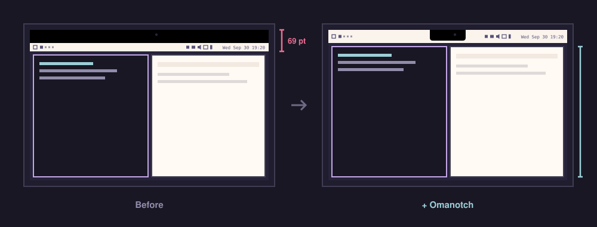

<h1 align="center">Omanotch</h1>

<h3 align="center">Enabling the MacBook notch in Omarchy VMs</h3>

The real Omarchy bar, right where the VM app leaves a black hole.

  <b>Part of <a href="../../README.md">OmacVM</a></b>, which sets it up with the VM: the <code>omanotch</code> feature, on by default on a MacBook with a notch.

  

You run [Omarchy](https://omarchy.org) full screen in OmacVM.app on a
MacBook with a notch. The strip beside the
notch stays black, and Omarchy draws its own bar below it. **Omanotch** puts
Omarchy's **real** bar into that strip (the actual Quickshell bar, pixels and
all) and gives the space the bar used to take back to your windows.

  

## The black strip

In full screen a VM app puts its window *below* the camera housing. The
strip beside the notch (the menu bar's height, 43 points on a 16-inch MacBook
Pro at "More Space") stays black, and Omarchy's 26-point bar comes below it:
about 69 points of screen, gone. The VM cannot go up there: **macOS** lets
only the app that owns a window place it next to the notch; moving the VM
app's window there from outside is refused.

**But a tiny Mac app of our own can**, and it can show whatever the VM would
have shown.

## How the trick works

1. **An invisible monitor.** Inside the VM, Hyprland gets an extra, headless
   output called `NOTCH`: exactly as wide as your screen, exactly as tall as the
   bar. Nobody ever sees it. In OmacVM.app it sits right above the built-in
   display, where the strip is on the Mac; the app maps its pointer by the
   outputs the guest reports, so every click stays exact.
2. **The bar, twice.** Omarchy's bar is cloned with Omarchy's own
   `omarchy plugin clone` and patched: one copy renders on `NOTCH` (the pixels
   you will see), the copy on the real display shrinks to 1 px and hides just
   off screen. It is not gone, though — your clicks are pressed on that hidden
   copy, so Omarchy opens its panels (clock, audio, network, …) on the visible
   display, right below the notch. The wallpaper is patched the same way: it is
   laid out once across the strip and the display (as one screen, the strip
   on top), so with the bar hidden (Super+Shift+Space) the image runs straight
   through the notch strip.
   Omarchy's display panel gets a patched copy too (`omanotch.monitor`), so
   `NOTCH` is not listed there as a display to scale or switch off.
3. **Streaming only what changes.** `notchcast`, a small C program in the VM,
   captures `NOTCH` with Wayland's `ext-image-copy-capture`. A capture only
   completes when Hyprland actually repaints, so an idle bar costs zero CPU. It
   sends just the rectangle that changed, LZ4-compressed — usually 0.5–3 KB —
   over the VM's private network.
4. **A panel above everything.** *Omanotch.app* draws the frames in a
   borderless panel at window level 27, above the menu bar (24). It never takes focus,
   so your keyboard stays with the VM. It lives on the VM's full-screen Space
   and slides with it when you swipe.
5. **Cursor juggling.** Over the strip, the Mac shows the *guest's* cursor
   images (sent over from the VM) while the VM hides its own; over the VM, the
   macOS cursor is hidden for real. One cursor at a time.
6. **Fail-safe.** The Mac app says "keep the bar parked" every second. If you
   leave full screen or the Mac app quits or crashes, the VM brings its bar
   back at once; if even the program in the VM dies, within 15 seconds.

## What it handles

  

Notifications never cut into the strip, theme switches don't make it jump,
hiding the bar lets the wallpaper run through behind the notch, full-screen
video and the lock screen turn it black, and it follows you across Spaces and
MacBook sizes.

## Skip the notch

OmacVM.app has a switch for it (off by default): on the bar beside the notch,
items that no longer fit on their side jump over the camera housing and
continue on its other side, in the same order. They only hide when that side
is full too. The menu and the clock at the far right stay put, and bars on
other displays are not touched. Omarchy's hidden indicators (Dictate, Screen
Recording and the others) open where they are when they fit right of the
notch; when they don't, they open left of it, so the rest of the bar stays
where it is and the notch looks untouched until you point at the bar. On
Omarchy 4.5 they open when the pointer comes onto the indicators, or onto the
place left of the notch where they open; once open, they stay open while it
crosses the notch and the items between the two, and shut when it goes left
of them. The notch and those items never open them, and Omarchy's own rule
(the bar left of its centre) counts only in Omarchy's own layout (the
indicators there, not moved by Skip the notch) and only left of the notch
(bar patch v42, #763, #765). On Omarchy 4.5 the strip's workspaces are those
of the display the strip stands for, as on 4.0: Omarchy 4.5 loads its
workspaces widget from its own folder, so the strip's bar uses the bar copy's
own `widgets/Workspaces.qml` instead (bar patch v43, #760; the other bars keep
Omarchy's; `omarchy-shell notchbar state` says `"workspaces": "copy"`). Omarchy
4.5's tray counts with its drawer open: it sits where the drawer opens in full,
and does not move while the drawer slides open; what jumps left of the notch
keeps clear of the room 4.5's hidden indicators open into there (so on a full
bar a few more items hide there than on 4.0). An item shows where it stays: one
that grows or shrinks takes its new place at once, and one that shows up (the
tray when its first app starts) waits unseen until its own place has been
quiet for 150 ms (1 s at most); the tray waits until its apps stop coming
(1.5 s without a new one, 8 s at most, also at login), so apps that start a
second or so apart show it once, on the side it stays on (#757). Meanwhile its
place is empty and takes no clicks. Only items pushed by others glide. A tray
app that starts later than that can still move the tray to the other side once. The bar patch does the layout
(`notchSkipPlace`); the app tells the VM through `/run/omacvm/host.env`
(`OMACVM_NOTCHSKIP=1`) and `/run/omacvm/notch-skip`.

## Any notched MacBook

Nothing is tied to one model. The Mac app measures everything on the spot:
where the camera housing is, how tall the strip is, and how many guest pixels
land on one Mac point. 13- and 15-inch MacBook Air, 14- and 16-inch MacBook
Pro, any "Larger Text" to "More Space" setting — the invisible monitor, the
notch gap in the bar and every click follow along, also when you change the
resolution while the VM is running. If the VM's resolution does not match the
Mac point for point, the strip is scaled to fit instead of cut off.

## Requirements

- A MacBook with a notch, Omarchy full screen in OmacVM.app on the built-in display.

## Install

[OmacVM](../../README.md) installs both sides (`omacvm enable omanotch` on an
existing VM). To work on Omanotch itself, from `src/omanotch` of an OmacVM
checkout: `./guest/install.sh` in the VM as your user, `./mac/install.sh` on
the Mac (builds `~/Applications/Omanotch.app`, starts it at login, logs to
`~/Library/Logs/omanotch.log`). `./guest/uninstall.sh` (with
`--remove-bar-clone` to drop the bar clone too) and `./mac/uninstall.sh`
remove them.

## Configuration

Mac app — `defaults write ch.gillesgoetsch.omanotch <key> <value>`, then
`launchctl kickstart -k gui/$(id -u)/ch.gillesgoetsch.omanotch`:

| Key | Default | |
|---|---|---|
| `vmOwners` | OmacVM.app | apps whose full-screen window is the VM (`-array …`) |
| `vmInterfacePrefixes` | `bridge` | VM network interfaces the Mac listens on (OmacVM.app's fast network) … |
| `vmSubnets` | *(none)* | … and other VM networks to serve besides OmacVM.app's own (127.0.0.1 and its fast network, always); guests are accepted only from that network. The retired Parallels, UTM and VMware Fusion networks are not served since OmacVM 3.4.0 |
| `listenHost` | *(automatic)* | listen on this one IPv4 address instead |
| `flush` | `false` | `true`: the bar is exactly as tall as the camera housing, as in OmacVM.app's notch-strip mode; the few points of the strip below it show the wallpaper. `false`: the bar fills the strip (macOS's menu bar height). Taken up within two seconds, no restart needed |

A test Omanotch for OmacVM's test identity ("OmacVM Test", whose VMs reach
port 47911 and use the test Bridge's token) takes those two from its launch
arguments only: `open -n Omanotch.app --args -port 47911 -bridgeDir
omacvm-test-bridge`. Saved `port` and `bridgeDir` settings are never used;
Omanotch removes them at start, so a test cannot leave your own Omanotch on
the test port.

VM — `systemctl --user edit notchcast`, `Environment=…`:

| Variable | Default | |
|---|---|---|
| `NOTCHBAR_HOST` | `10.0.2.2` (omacvm apply) | the Mac's address (list allowed); on OmacVM.app's fast network its gateway, 192.168.77.1 |
| `NOTCHBAR_PORT` | `47811` | |
| `NOTCHBAR_OUTPUT` | `NOTCH` | name of the invisible monitor |
| `NOTCHBAR_SCREEN` | `Virtual-1` | the built-in display's output; by default OmacVM.app names it (with external displays it can be `Virtual-2` or later) |
| `NOTCHBAR_FOLLOW_MODE` | `0` (omacvm apply; on under QEMU without it) | `1`/`0`: when a QEMU VM app resizes the display to its window while running, apply and keep that size (Hyprland does not pick it up by itself) |

## Good to know

- The lock screen turns the strip black too: Omarchy draws its lock screen,
  password field included, on every output, and nothing is streamed while the
  session is locked.
- Full-screen video (or anything in real fullscreen, Super+F) turns the strip
  black, like macOS does. Maximized and tiled-fullscreen windows keep the bar.
- Omarchy's notification popups sit right under Omanotch's bar: with the bar
  parked in the strip, only the normal gap below it; with OmacVM.app's full
  panel, the strip's height plus the gap. The bar tells the notification
  service its room per display (`barSizeFor`); on an older service OmacVM
  patches Omarchy's file (`src/guest/omanotch-notifications.sh`), since cloned
  copies of it run sandboxed. With the bar hidden they keep Omarchy's own
  distance.
- Hover effects (tooltips, hover highlights) are not mirrored; clicks, right
  and middle clicks and scrolling are. The one hover the strip passes on: the
  pointer on the bar's free space shows Omarchy's auto-hidden indicators, and
  they stay until it leaves the strip, as on the bar itself. On Omarchy 4.5
  the strip does what the bar does: the indicators open on their own places
  (and left of the notch where they sit there); under the notch they only
  stay open once they are.
- Omarchy's tray works in the strip (#662): its icons take left, right and
  middle clicks and scrolling as on the bar itself, and a left click on the
  drawer's arrow opens or closes the drawer (on the bar it opens on hover,
  which the strip does not pass on). The drawer closes when the pointer
  leaves the strip. A right click on the arrow still opens the tray's list.
- The bar and background clones follow Omarchy's updates the way Omarchy
  updates its own plugins (`omarchy plugin update`: your changes stay when
  they don't touch what comes in, the update is refused when they do, and
  rolled back when it fails). After an update of Omarchy's bar or background
  (OmacVM's pacman hook, and at each login: `omanotch-copies.service`,
  `guest/copies.py`) a clone becomes Omarchy's new plugin with the patch again,
  merged three ways with your clone against what Omanotch wrote the last time
  (`~/.local/state/omanotch/copies/`), so your own edits stay when they merge
  cleanly. When they overlap Omarchy's changes, or the patch does not fit the
  new file, the clone stays as it is and `omacvm check` (and the control
  centre) say so, with both sides marked in `.../copies/<name>/conflict`.
  After a change the shell restarts and must load the clone without errors,
  else every changed file goes back. The display panel copy is built again by
  itself when Omarchy's panel changed (at the next notchcast start); if the
  patch no longer fits, Omarchy's own panel comes back.
- Hyprland warns about overlapping monitors after layout changes. The overlap
  is deliberate; `notchbar.lua` dismisses that one warning and nothing else.
- Several VMs at once: the strip shows the bar of the VM whose window is full
  screen on the built-in display, and only that VM's bar is parked; the
  others keep their own bar. Omanotch needs no macOS permission for this: it
  knows the window's app, not which of its VMs the window shows. With two VMs of one app connected, the
  strip keeps the one it serves, else takes the one that connected last;
  switching between them does not switch the strip.
- OmacVM.app's VMs reach the Mac at 127.0.0.1, where any Mac program could
  connect, or listen in Omanotch's place. There `notchcast` and the Mac first
  prove to each other that they know OmacVM's Bridge token (HMAC-SHA256 over
  two nonces and 127.0.0.1, the Mac first), so the token itself is never
  sent; a connection that has not proved it yet does not get in the way of a
  connected VM. The same on the app's fast network (vmnet, the Mac at
  192.168.77.1; the proof then names that address): `notchcast` takes it when
  it is the VM's gateway, and connects again when the app moves the VM between
  the two networks. The protocol is in `mac/Sources/GuestAuth.swift`.
- On an older Omarchy (up to about September 2026) the bar patch also makes the
  cloned bar loadable at all; newer versions don't need that. The bar and
  background patches fit omarchy-mac's shell and upstream Omarchy's from
  October 2026 (a notch floor, a bar thickness per screen, the wallpaper
  decoded at the display's size). A clone from before the copies kept a record
  (OmacVM 3.1.11 and older) is made new from the installed Omarchy once, at the
  next `./guest/install.sh` (OmacVM's Update VM). If it differed from what
  Omanotch makes (your edits, an older Omarchy or patch), the whole folder is
  kept first beside it, hidden from Omarchy
  (`~/.config/omarchy/plugins/.$USER.bar.before-3.1.13`), and `omacvm check`
  says where for two weeks or until it is deleted.
- Cursor handling uses the window-server property `SetsCursorInBackground`,
  which is not public API (but widely used and stable for years).
- At the exact moment the pointer crosses into the strip you may catch a
  ghost of the VM cursor for a frame or two: the VM draws its own cursor and
  the display pipeline has a little latency.

## Tip: a macOS-style clock

With the bar in the menu-bar spot, a macOS-like clock at the far right feels
natural. In `~/.config/omarchy/shell.json`, move the `omarchy.clock` entry to
the end of `bar.layout.right`, give it `"format": "ddd MMM d HH:mm"`
(→ `Wed Sep 30 19:20`) and set `"centerAnchor": ""`. The shell picks the change
up by itself.

## Troubleshooting

| Symptom | Look at |
|---|---|
| Strip stays black | `~/Library/Logs/omanotch.log` ("listening on …", "guest connected"?) · in the VM: `systemctl --user status notchcast` |
| Bar in the VM *and* in the strip | `omarchy-shell notchbar state` → `parked` should be `true` and `screen` the built-in display · `~/.local/state/omanotch/park` is what notchcast asked for (`1 <output>`; `w <output>`: connected, Omanotch's word still to come); the bar follows it within 3 s, also after a shell restart |
| No bar for a few seconds after login | the strip showed at the end of the last session, so the bar started in the strip (`~/.local/state/omanotch/expect` says `1 <output>`). With the VM windowed now, Omanotch gives the bar back as soon as it connects; an older Omanotch, or none running, after 8 s, and the next login starts normally. A Mac restart or an Omanotch quit with the VM running keeps the hint |
| OmacVM.app: the strip stays black | `~/Library/Logs/omanotch.log` ("refused a connection on 127.0.0.1: …", or on 192.168.77.1 on the fast network) · in the VM: `journalctl --user -u notchcast` ("answered no proof": the Mac's Omanotch is older than the VM's, update it) |
| Strip shows another VM's bar | two VMs of one app are connected: Omanotch tells apps apart, not VMs of one app (`~/Library/Logs/omanotch.log`: "strip serves guest …"); stop the other VM or restart its `notchcast` |
| No bar on the built-in display after the notch strip went away (Omarchy 4.0, bar patch v37 and older) | `hyprctl layers`: the bar at `0,-1`, 1 px tall, and `hyprctl monitors`: reserved top 0, so the parked window kept its size (#727). `omarchy-toggle-bar` twice, or any window opened on that display, brings it back; Update VM gives patch v39, which maps the bar's window again when the notch park ends |
| Mouse lands in the wrong place | `hyprctl monitors` → `NOTCH` must have the built-in display's x and width, and sit at its position (OmacVM.app: right above it, touching its top edge) |
| Panels open on the wrong screen | `NOTCHBAR_SCREEN` must name the built-in display (OmacVM.app: `$XDG_RUNTIME_DIR/omacvm/builtin` does, `omacvm check` → "notch display") |

## Credits

- [Omarchy](https://omarchy.org) by DHH and contributors — the bar, the
  shell, the whole beautiful thing
- [Hyprland](https://hyprland.org) and [Quickshell](https://quickshell.org)
- Not affiliated with Omarchy or Apple. Omarchy's bar,
  background and display panel code is not included here: it is cloned from your own Omarchy
  installation and patched at install time.

## License

MIT — see [LICENSE](LICENSE).
